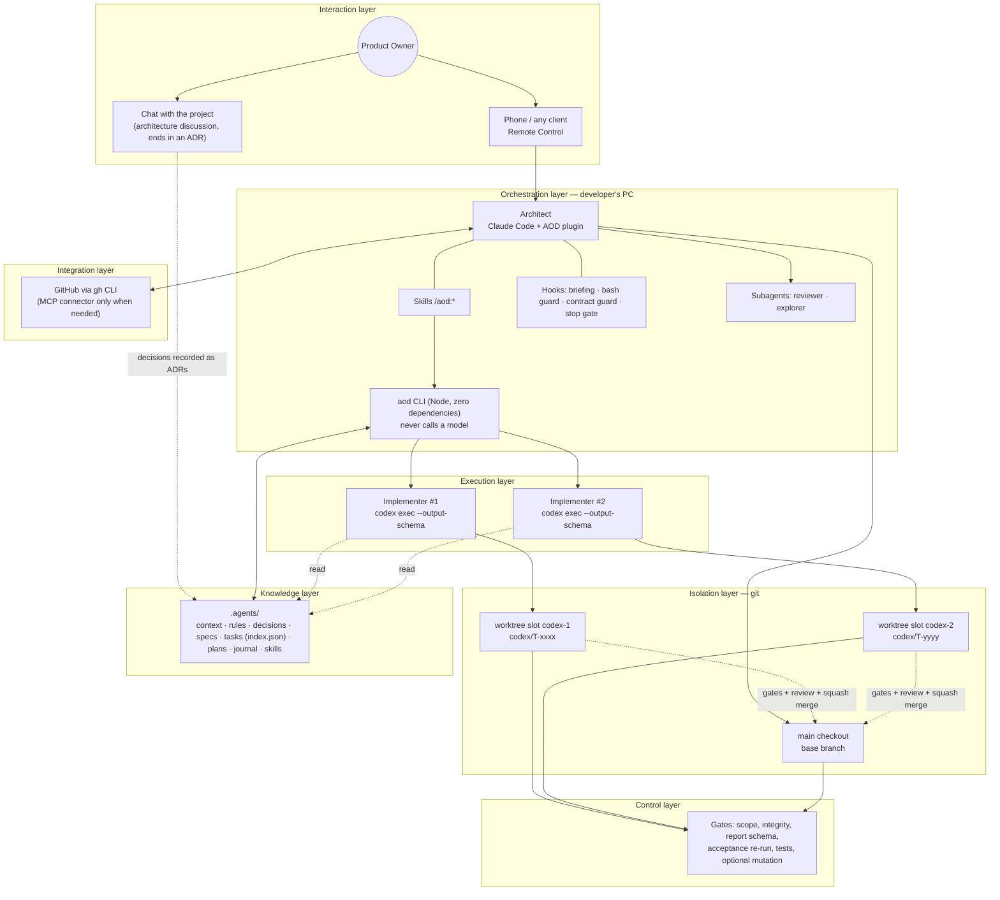
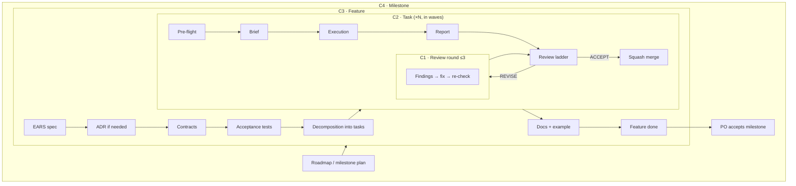
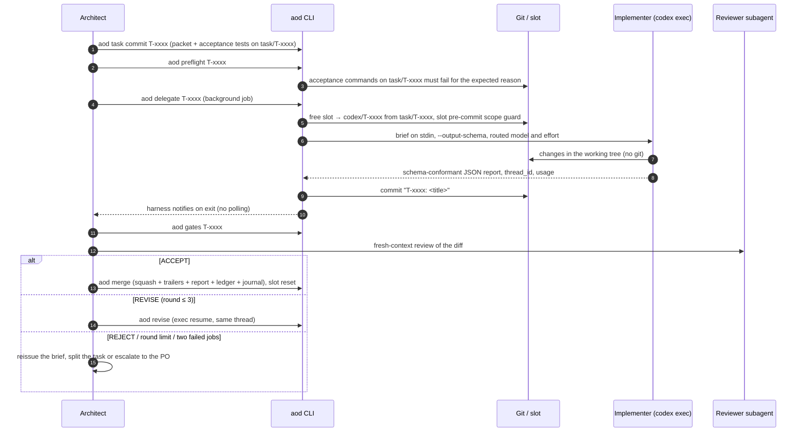
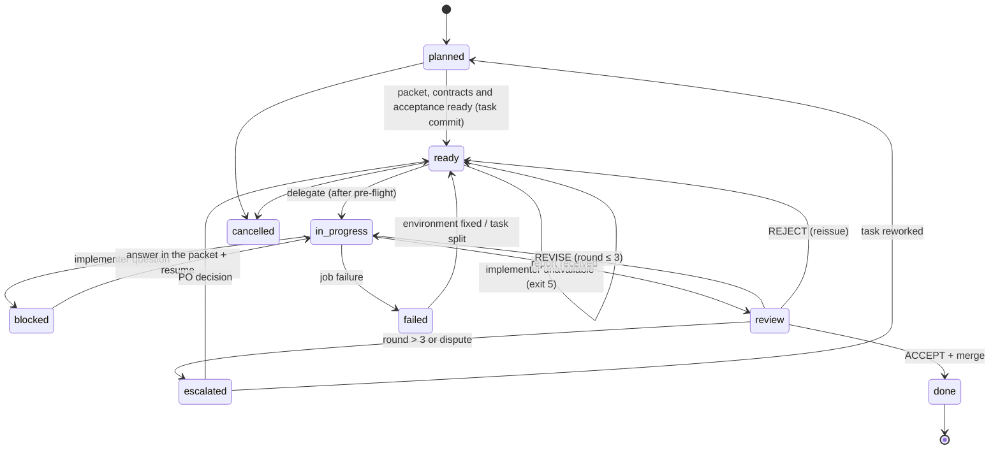

# AOD — Architect-Orchestrated Development

A methodology for building a software product with a team of one product owner, one architect model and
parallel coding agents.

Version 2.0 · 2026-10-17

> English edition of the AOD 2.0 methodology. The Russian edition is
> [aod-methodology-RU.md](aod-methodology-RU.md); both use the same section numbers, so references such as "§18" or
> "§21.4" mean the same section in both. Version 1.0 is kept in the git history. Changes from 1.0 come
> from [aod-2.0-research.md](aod-2.0-research.md) and the decisions in
> [.agents/decisions/](../.agents/decisions/index.md); the Claude Code plugin in this repository implements them.
> Changed or new material is marked **2.0**.

---

## Contents

1. [The underlying problem](#1-the-underlying-problem)
2. [Process principles](#2-process-principles)
3. [Glossary](#3-glossary)
4. [Roles and rights](#4-roles-and-rights)
5. [Technology stack](#5-technology-stack)
6. [Workspace and repository](#6-workspace-and-repository)
7. [Cycle hierarchy](#7-cycle-hierarchy)
8. [Feature cycle](#8-feature-cycle-c3)
9. [Task cycle](#9-task-cycle-c2)
10. [Review round](#10-review-round-c1)
11. [Task state machine](#11-task-state-machine)
12. [Session](#12-session)
13. [Parallelism](#13-parallelism)
14. [Working with the product owner and remote control](#14-working-with-the-product-owner-and-remote-control)
15. [Integrations via MCP](#15-integrations-via-mcp)
16. [Artefact formats](#16-artefact-formats)
17. [Security and red lines](#17-security-and-red-lines)
18. [Metrics](#18-metrics)
19. [Limits of applicability and failure modes](#19-limits-of-applicability-and-failure-modes)
20. [Starting a new project (bootstrap)](#20-starting-a-new-project-bootstrap)
21. [Appendix: templates](#21-appendix-templates)

---

## 1. The underlying problem

When LLM agents do the development, the bottleneck is not how fast code is generated. It is six shortages.

| # | Shortage | How it shows | AOD mechanism that addresses it |
| --- | --- | --- | --- |
| D1 | The strong model's attention is expensive | The strong model spends its token budget on boilerplate that a cheaper model could write | Role separation: the strong model decides and verifies, implementers write code (§4); model routing by task (§5.4) |
| D2 | Context does not survive the session | Every new session starts from zero; decisions made in chat dissolve | Project memory in the repository: `.agents/` (§6.3), a JSON task ledger (§16.7) |
| D3 | Self-verification is unreliable | A model checking its own code shares its blind spots; an agent's report is confident but not necessarily correct | Deterministic gates first, then a fresh-context reviewer, preferably of another model family (§10) |
| D4 | The product owner is physically absent | Decisions wait until the human is back at the computer | Remote Control, asynchronous decision requests (§14) |
| D5 | Parallel agents get in each other's way | Conflicts in one working copy, races for build caches, "foreign" edits | Isolation through git worktree slots and the task scope (§13) |
| D6 | **2.0** Model usage is a shared, rolling budget | Chat, the architect and the implementers draw from the same subscription pools; default models and high reasoning effort drain them fastest | Cheapest mechanism first (P11), routing presets (§5.4), usage tracked per task (§18) |

Historical context. In essence AOD carries the classic organisation of an engineering team over to agents:
technical lead/architect, developers, code review, Architecture Decision Records (Nygard, 2011),
trunk-based development, Design by Contract, acceptance-test-first. The adjustments follow the properties that
set an agent apart from a human developer:

- it remembers nothing between sessions, so all memory is external and explicit;
- it does not ask questions in time and confidently fills gaps with guesses, so the specification must be
  exhaustive and ambiguity is a reason to stop (`blocked`), not to improvise;
- it tends to "fix" the check instead of the code (loosen a tolerance, skip a test, special-case the expected
  value), so contracts and acceptance tests are read-only for it. **2.0:** published benchmarks show both Codex
  and Claude Code doing this, and a literal stop rule in the brief cuts it sharply, so read-only tests are
  necessary but not sufficient (§10.4);
- **2.0:** its quality degrades as its context grows, so sessions are short, bulk reading is delegated and diffs
  are reviewed by area;
- it is cheap and parallelises, so it pays to cut work into many small independent tasks.

---

## 2. Process principles

These are invariants: if a specific project setting contradicts a principle, the setting is wrong.

| ID | Principle | Statement |
| --- | --- | --- |
| P1 | Separate deciding from doing | Whoever makes the architectural decision does not write the bulk of the code; whoever writes the code does not change the decisions |
| P2 | Contracts first | Schemas, interfaces and acceptance tests exist before the implementation and are fixed by the architect |
| P3 | Repo as memory | Everything significant is recorded in the repository (`.agents/`). What is not in the repository does not exist for the next session |
| P4 | Verify, don't trust | The implementer's report is a hypothesis. The fact is a run of the acceptance commands and a reading of the diff by the reviewer |
| P5 | Independent verification (**2.0**, restated) | Deterministic gates first, then a reviewer that starts from a fresh context, preferably of another model family. The order of value is gates > fresh context > family diversity. Code the architect writes itself is reviewed by the other family too |
| P6 | Isolated execution | One task = one implementer = one branch = one slot. The main working copy is out of the implementer's reach |
| P7 | Bounded cycles | Every cycle has an exit criterion and an iteration limit; exceeding the limit leads to escalation, not endless rework |
| P8 | Asynchronous owner | The product owner does not need to be at the computer. Everything that needs them is phrased as a decision with options and a recommendation |
| P9 | Reference, don't paste | Agents receive file paths, not file contents; briefs are short |
| P10 | Traceability | Every change on the base branch traces back to a task → spec/ADR → journal entry |
| P11 | **2.0** Cheapest mechanism first | Deterministic checks run first and always; small models do volume; the strongest model sees only decisions and disputes. A token never sent is the cheapest one |
| P12 | **2.0** Enforce, don't instruct | Every red line that can be checked mechanically is a hook or a gate, not a sentence in `AGENTS.md`. Instructions keep only what needs judgment |

---

## 3. Glossary

| Term | Definition |
| --- | --- |
| Product Owner (PO) | A human. Owns the vision, requirements and red lines; makes the decisions that cannot be derived from the available context |
| Architect-Orchestrator, architect | The strong model. Makes architectural decisions, writes contracts and acceptance tests, cuts work into tasks, delegates, verifies, merges |
| Implementer | A coding agent on a model of another family. Implements exactly one task inside its scope |
| Reviewer | The function of independently checking a result. **2.0:** by default a fresh-context subagent with the review checklist; the architect gives the verdict |
| Gate | A non-LLM check: tests, linters, type checker, scope guard, integrity checks, report validation, optional mutation testing |
| Hook | **2.0** A deterministic script the agent harness runs on an event (session start, before a tool call, at the end of a turn). Cannot be argued with |
| Skill | **2.0** A procedure (`SKILL.md`) loaded on demand. Replaces the 1.0 playbooks as the executable form of a procedure |
| Delegation runner | **2.0** Replaces the 1.0 bridge. `aod delegate` runs the implementer non-interactively (`codex exec` with an output schema) in a slot, as a background job the harness reports on when it exits |
| Workspace | Optional root folder (not git) grouping a project's repositories, slots and agent configuration. **2.0:** a single repository with a sibling slots directory is enough |
| Slot | A persistent git worktree for an implementer. Slots are reused, not created per task |
| Contract | A machine-checkable description of an interface: data schema, API, signature. The single source of truth |
| Acceptance tests | Tests written by the architect before the implementation that fail "for the right reason". The implementer cannot change them |
| Spec | A description of a feature or screen before implementation. **2.0:** requirements are written in EARS syntax, each traced to an acceptance test. The PO approves large specs |
| EARS | **2.0** Easy Approach to Requirements Syntax: "When \<trigger>, the system shall \<response>" and related patterns; one sentence maps to one acceptance test |
| ADR | Architecture Decision Record: one significant decision (context, decision, consequences, status). An accepted ADR is binding |
| Task packet | A file `T-xxxx.md` with YAML front matter (scope, contracts, constraints, acceptance commands, budget) and a short body. The unit of delegated work |
| Brief | The message with which the architect starts an implementer. It refers to the task packet and does not duplicate it |
| Scope | The list of globs the implementer may change. Everything else is read-only for it |
| Report | The implementer's JSON document in a fixed schema: status, commits, files, check runs, deviations, questions, risks. **2.0:** enforced by the implementer's runtime through the output schema |
| Ledger | **2.0** `.agents/tasks/index.json`: the single, schema-validated source of truth for task status, rounds, slot, thread, model, usage and event history. `index.md` is generated from it |
| Routing preset | **2.0** A named mapping of roles (implement, escalate, explore) to model and reasoning effort |
| Wave | **2.0** A set of ready tasks with done dependencies and disjoint scopes that run in parallel, one per slot |
| Unlock | **2.0** A time-boxed, logged permission for the architect to edit protected paths (contracts, acceptance tests) |
| Verdict | The outcome of a check: `ACCEPT`, `REVISE` or `REJECT` |
| Finding | A review item with a severity, a location in the code, a required change and a verification command |
| Round | One iteration of "findings → fix → re-check". The limit is 3 rounds |
| Escalation | Handing a decision to the PO in the form "task, disagreement, options, recommendation" |
| Session | A time-bounded stretch of the architect's work with a start and an end protocol |
| Journal | One entry per session: what was done, what was not, decisions taken, open questions, next step |
| Playbook | A step-by-step procedure for a recurring operation. **2.0:** shipped as a skill |
| Definition of Done (DoD) | The project-wide list of conditions without which a task is not complete |
| Milestone | A delivery with measurable exit criteria that the PO accepts |

---

## 4. Roles and rights

### 4.1. Product Owner

Does: shapes the vision and requirements, sets the red lines; approves large specs and milestones; resolves
escalations; decides matters of taste, priorities, licensing and money. Does not: write code or micromanage
tasks. Their time is the scarcest resource in the system, so every request to them is a menu of options ready
for a decision.

### 4.2. Architect-Orchestrator

Does: keeps the architecture coherent; writes ADRs, contracts, specs and acceptance tests; cuts work into tasks
and builds the dependency graph; prepares slots and briefs; monitors implementers; verifies every result
personally; is the only one who merges to the base branch; keeps the journal, the plan and the task ledger;
works with external services (issues, PRs, releases). May implement what is not delegated (see §9.1): UI/UX,
the security core, small fixes. **2.0:** code the architect writes itself is reviewed by the other model family
before it is committed (`/aod:cross-review`), which closes the 1.0 gap where that code went unreviewed.

### 4.3. Implementer

Does: implements one task inside its scope; writes unit tests for its code; runs the acceptance commands;
produces the report. Does not: ask questions mid-task (when something is unclear it stops with status
`blocked` and one precise question); change contracts, acceptance tests, ADRs or `.agents/`; push, rewrite
history or switch branches; use nested agents, MCP tools, the web or visualisations unless the packet
explicitly allows it.

**2.0:** the implementer runs in a sandbox that keeps `.git` read-only and makes no commits at all. It leaves
its changes in the working tree; AOD commits them (`T-xxxx: <title>`, author "Codex (AOD implementer)") after
the run, and the scope gate judges every file. The report is written through the output schema, not
committed by the implementer.

### 4.4. Reviewer

A function, not necessarily a separate agent. The main requirement is independence from the implementer: a
fresh context and its own run of the checks. **2.0:** the default reviewer is a read-only subagent that starts
with a clean context and reads the diff against the packet, spec and review checklist; the architect gives the
verdict. Family diversity is a secondary diversifier: Codex output is reviewed by a Claude subagent, Claude
output by Codex (`codex exec review`). When one family's budget is exhausted, a fresh-context reviewer of the
same family is a legitimate substitute.

### 4.5. Gates

Non-LLM checkers that cannot be talked round: tests, formatters, linters, type checker, scope guard (a check
that the task branch's commits touch only paths from `scope`), JSON Schema validation of the report, a licence
audit of dependencies. **2.0** adds integrity checks (deleted or renamed tests, new skip/only/xfail markers,
production code that detects a test run; modified tests, changed tolerances and comparisons against acceptance
literals are flagged for the reviewer) and optional mutation testing on changed files (§10.4).

### 4.6. Hooks (**2.0**)

Hooks enforce red lines inside the agent harness itself, before a model can act: a session briefing, a Bash
guard against destructive git and shell writes to protected paths, a contract guard on file edits, and an
opt-in "done means green" check at the end of a turn. They are silent outside an initialised AOD repository and
fail open on internal errors (§17.2).

### 4.7. Rights matrix

D = decides, W = writes, R = reads, — = no access.

| Artefact | PO | Architect | Implementer | Gates and hooks |
| --- | --- | --- | --- | --- |
| Vision, requirements, red lines | D | W | R | — |
| ADRs | D (large ones) | D/W | R | contract guard blocks edits to accepted ADRs |
| Specs | D (large ones) | W | R | EARS lint |
| Contracts (schemas, API) | — | D/W (through an unlock) | R | check; contract guard protects |
| Acceptance tests | — | D/W (through an unlock) | R | run; contract guard protects |
| Task packets, plan, ledger | — | W | R | validate front matter and ledger schema |
| Code in the task scope | — | R (review) | W (uncommitted; AOD commits) | check scope and integrity |
| Task report | R | R | W (through the output schema) | validate the schema |
| Journal | R | W | — | `aod journal check` |
| Base branch (`main`) | — | W (squash merge) | — | protect |
| Agent configuration (`AGENTS.md`, `CLAUDE.md`, `aod.config.json`, hooks) | — | W | R | — |

---

## 5. Technology stack

### 5.1. Layers



### 5.2. Components and their purpose

| Layer | Component (default choice) | Purpose | Replaceable? |
| --- | --- | --- | --- |
| Interaction | Remote Control for Claude Code | The PO drives the architect's local session from a phone or another device | Yes: any channel to the same session |
| Interaction | Chat with a connected project | Long architecture discussions; the outcome is written into the repository as an ADR. **2.0:** draws from the same usage pool as coding, so it ends in an ADR, not more chat | Yes |
| Orchestration | Claude Code with the AOD plugin, started in the repository | Architect: builds, tests, works with git, delegates | Core of the method |
| Orchestration | **2.0** Skills (`/aod:*`) | Executable procedures, loaded only when used | The procedures are core; the format is the harness's |
| Orchestration | **2.0** Hooks | Deterministic enforcement of red lines (§17.2) | Core of the method |
| Orchestration | **2.0** `aod` CLI (`scripts/aod.mjs`, Node.js >= 20, no npm dependencies) | All mechanics: slots, delegation, gates, merge, ledger, journal, ADRs, specs, retro. Skills call it; it never calls a model | Yes, if the operations stay |
| Orchestration | `AGENTS.md` (shared), `CLAUDE.md` (architect-specific, a thin `@AGENTS.md` import) | Instructions agents load automatically from `cwd` upwards | File names depend on the agents |
| Execution | **2.0** Codex CLI via `codex exec` (non-interactive, `--output-schema`, `--json`, `exec resume`) | Implementing tasks; revisions resume the same thread | Yes: any agent with a non-interactive mode, an output schema and session resume |
| Execution | **2.0** Subagents (reviewer, explorer) | Fresh-context review; bulk reading that would otherwise fill the architect's context | Yes |
| Isolation | git worktree; branches `task/*`, `codex/*`, `claude/*`, `slot/*` | Parallel work without conflicts, shared object store | Core of the method |
| Isolation | Shared caches (ccache, uv, pnpm…) | Cheap slots: builds do not start from scratch | Depends on the stack |
| Knowledge | `.agents/` in the product repository | Project memory for agents and people | Core of the method |
| Integrations | **2.0** `gh` CLI called from a skill; MCP connectors only when a task needs them | Issues, PRs, comments, merges, tags and releases | Yes: GitLab etc. |
| Control | Gates (`aod gates`), CI, pre-commit formatters | Gates from §4.5 | Core of the method |

### 5.3. Why the implementer is a model of another family

Cost is part of it: the implementer's family draws from a separate usage pool. **2.0** corrects the 1.0 claim
that cross-family review is the main source of independence. Research on LLM judges shows that most of the
measured benefit comes from a deterministic verifier and a reviewer with a fresh context; models of different
families still share biases about style and structure. Family diversity therefore stays, as a secondary
diversifier where it is cheap: Codex implements and a Claude subagent reviews; Claude implements and Codex
reviews. All of this works only if P4 holds: the reviewer runs the acceptance commands and reads the diff, not
a retelling of it.

### 5.4. Model routing (**2.0**)

Routing is the largest cost lever. Each kind of work goes to the cheapest model that does it well.

| Work | Agent and model class | Effort |
| --- | --- | --- |
| ADRs, specs, contracts, acceptance tests | Architect, strongest model (plan mode) | high |
| Briefs, ledger and journal updates, merges | Architect, mid-tier model; skills carry the structure | medium |
| Bulk reading, "where is X" | Explorer: small model, read-only (`/aod:explore`) | low |
| Well-specified implementation | Implementer, `implement` role | medium |
| Hard task, a task that failed, review round 2+ | Implementer, `escalate` role | high |
| UI/UX implementation | Architect (taste stays with the architect); Codex reviews | medium |
| Review of implementer output | Gates, then a fresh-context subagent with the checklist | medium |
| Review of architect output | Codex review (`aod review`) | medium |
| Formatting, renames, codegen | Scripts and hooks, no model | — |

The implementer roles are configured in `aod.config.json` under `routing` (`implement`, `escalate`,
`explore`, each `{model, effort}`) and switched with `aod route preset economy|balanced|max`. Model names are
data, not methodology: they change faster than the method, and a model missing from the local Codex cache is a
warning, not an error. Escalation is by evidence: `escalate` is used once a task has a failed job and from review
round 2; a packet's own `model`/`effort` or a CLI flag overrides the routing. High reasoning effort is the
exception, not the default. Pin the architect's subagent model explicitly so exploration never runs silently on
the strongest model.

---

## 6. Workspace and repository

### 6.1. Workspace

**2.0:** the default layout is a single repository with a sibling directory for slots
(`worktrees_dir: "../<repo>-worktrees"` in `aod.config.json`). The multi-repository workspace below remains an
option when a project needs a public repository or a legacy reference next to the product.

```text
<project>-workspace/                 # NOT a git repository; root of the architect's session
├── AGENTS.md                        # map of repositories and rules for all agents
├── CLAUDE.md                        # architect role; imports AGENTS.md
├── .claude/                         # architect's local settings
├── <product>/                       # main private repository (main checkout)
├── <product>-sdk/                   # optional: public repository (strict leak boundary)
├── <product>-legacy/                # optional: previous implementation, READ-ONLY
└── <product>-worktrees/             # implementer slots
    ├── codex-1/                     # git worktree of <product>, branch slot/codex-1 or codex/T-xxxx
    └── codex-2/
```

Workspace rules: the root holds no working files other than agent configuration, which only the architect
maintains; a task works inside exactly one repository and obeys its `AGENTS.md`; legacy is read-only; internal
architecture, the content of `.agents/` and proprietary code never reach the public repository.

### 6.2. Product repository

```text
<product>/
├── AGENTS.md            # product description, "read before working", invariants, ownership map, DoD, "never"
├── CLAUDE.md            # architect specifics; @AGENTS.md
├── aod.config.json      # 2.0: base branch, slots, routing, protected globs, gates, timeouts
├── .agents/             # project memory (§6.3)
├── schemas/             # contracts, the single source of truth; owner: architect
├── tests/acceptance/    # acceptance tests; owner: architect
├── <code areas>/        # each area has an owner in the map: implementer or architect
└── docs/                # user documentation (docs-as-code)
```

The ownership map in `AGENTS.md` is a "path → purpose → owner" table. Unit tests sit next to the code and
belong to the code's owner. `/aod:init` scaffolds `AGENTS.md`, `CLAUDE.md`, `aod.config.json` and `.agents/`.

### 6.3. The `.agents/` folder

| Folder | Content | Changes when | Reader |
| --- | --- | --- | --- |
| `context/` | Stable knowledge: vision, glossary, invariants, architecture, domain model, formats, tech stack, validation | The architecture evolves (through an ADR) | everyone |
| `rules/` | Rules per language and area: code style, testing, git, security, docs, review checklist | A rule is added or refined | everyone |
| `decisions/` | ADR-xxxx + `index.md` with statuses + `template.md` | A significant decision is made | everyone |
| `specs/` | Feature (`S-xxxx`) and screen (`W-xxxx`) specs before implementation; **2.0:** EARS requirements | A feature is planned | architect, PO |
| `tasks/` | Packets `T-xxxx.md`, reports `T-xxxx.report.json`, `template.md`; **2.0:** `index.json` (ledger, source of truth), generated `index.md`, `jobs/` (git-ignored run artefacts) | Work is delegated or tracked | everyone |
| `plans/` | `roadmap.md`, milestone plan `M<n>.md`, `backlog.md` | Planning changes | architect, PO |
| `skills/` | **2.0** Skills for the implementer, e.g. `aod-implementer/SKILL.md`, which Codex loads in every slot | The implementer rules change | implementer |
| `journal/` | `YYYY-MM-DD-<slug>.md`, one entry per session | Every session | everyone, especially the next session |

Each folder has a `README.md`: what is stored there, how files are named, the template. **2.0:** the 1.0
`playbooks/` folder is replaced by skills; the architect's skills ship with the plugin, so a project only
keeps project-specific procedures.

Priority when documents contradict each other: accepted ADR > `context/invariants.md` > other `context/` >
`rules/` > specs > tasks. An agent that finds a contradiction reports it instead of choosing silently.

Why this works: `.agents/` is external long-term memory with an addressable structure. An agent does not need
to hold everything in context; `AGENTS.md` contains a "task type → what to read first" table, so each agent
loads the minimal sufficient subset (P9). For people, the same folder serves as documentation of decisions and
the project's history.

### 6.4. Branches

| Branch | Created by | Content |
| --- | --- | --- |
| `main` (base branch, configurable) | — | Trunk. Only the architect writes to it, through squash merges |
| `task/T-xxxx` | Architect (`aod task commit`, without switching the main checkout) | Packet + acceptance tests (+ contracts, specs and ADRs it depends on, all committed first) |
| `codex/T-xxxx` | Created in the slot from `task/T-xxxx`; **2.0:** AOD commits the implementer's changes | Implementation |
| `claude/<topic>` | Architect | The architect's own work |
| `slot/codex-N` | Architect | The slot's base branch at rest |

The implementer's changes are exactly `task/T-xxxx..codex/T-xxxx`, which is what the scope gate checks.
**2.0:** `aod task commit` refuses while the packet's spec or contracts are uncommitted on the base branch;
`aod task sync T-xxxx` brings a task branch up to date with the base branch without a checkout, and refuses once
the task is delegated unless forced.

Commits: Conventional Commits; task commits start with `T-xxxx: `. Squash merges carry `Implemented-by:` and
`Reviewed-by:` trailers. Links to AI sessions, chats and internal URLs never go into commits, PRs or tags.

---

## 7. Cycle hierarchy

Definitions:

- A cycle is a closed process with an input, an output and an exit criterion, whose owner is assigned in
  advance.
- An iteration is one pass inside a cycle. Every cycle has an iteration limit or a time budget.
- Cycles are nested: the output of an inner cycle is a step of the outer one.

| Level | Cycle | Trigger | Input | Output | Exit criterion accepted by | Scale |
| --- | --- | --- | --- | --- | --- | --- |
| C4 | Milestone cycle | Milestone starts per the roadmap | Milestone goals, exit criteria | Delivery accepted by the PO | PO | weeks |
| C3 | Feature cycle | Issue, requirement, need | Requirement | Spec, ADRs, contracts, acceptance tests, task graph, and in the end the feature on the base branch with docs | architect (PO for large specs) | days |
| C2 | Task cycle | Task in status `ready` | Packet, slot | One squash commit on the base branch (code, report, ledger, journal) | architect | minutes to hours |
| C1 | Review round | Verdict `REVISE` | List of findings | Fixes + re-check | architect; limit 3 | minutes |
| S | Session (orthogonal) | The PO or a schedule starts work | Journal, plan, ledger | Clean tree, journal entry, updated ledger | architect | hours |



The key property of the hierarchy: the cost of an error grows from the bottom up, and how often the PO is
involved falls from the top down. The PO always takes part in C4, in C3 for large specs and escalations, and in
C2/C1 only through escalation.

---

## 8. Feature cycle (C3)

| Step | What happens | Artefact | Owner |
| --- | --- | --- | --- |
| 1. Need | An issue, a PO requirement or the architect's conclusion | issue / backlog entry | PO, architect |
| 2. Spec | Behaviour, scenarios, boundaries, acceptance criteria. **2.0:** each requirement in EARS form with an `Acceptance:` line naming its test; `aod spec check` lints it (`/aod:spec`) | `.agents/specs/S-xxxx-*.md` | architect; the PO approves large ones |
| 3. ADR | Needed when a contract, dependency, format, scientific/domain model or the process changes (`/aod:adr`) | `.agents/decisions/ADR-xxxx-*.md` | architect; the PO decides contested ones |
| 4. Contracts | Schemas and interfaces from which the types for all layers are generated | `schemas/**` | architect |
| 5. Acceptance tests | Written before the implementation; fail for the expected reason (not because of syntax or an import) | `tests/acceptance/**` | architect |
| 6. Decomposition | Split into tasks with an explicit `depends_on` graph; each task is verifiable by its own acceptance commands (`/aod:packet`) | `.agents/tasks/T-xxxx.md`, ledger | architect |
| 7. Implementation | Cycle C2 for each task; independent ones run in parallel waves (§13) | branches, slots | implementers / architect |
| 8. Docs and example | User documentation and an example in the same change | `docs/`, `examples/` | architect or a task |
| 9. Closing | Update the milestone plan, the journal; close the issue | `plans/`, `journal/` | architect |

Decomposition rule: a task is good if its acceptance can be expressed as a list of commands, its scope as a
list of globs, and its solution needs neither taste nor a choice between equivalent architectural options.
Otherwise split it further or keep it for the architect. **2.0:** scopes must also be narrow and honest,
because the wave planner compares glob prefixes and a broad scope (`src/**`) blocks parallelism.

---

## 9. Task cycle (C2)

### 9.1. To delegate or not

| Delegate | Do not delegate (the architect does it or escalates) |
| --- | --- |
| Implementation against a ready spec with acceptance tests | Architectural and contract decisions |
| Porting old code with differential tests | Changes to schemas and acceptance tests |
| Bindings, serialisers, adapters, generators | UI/UX and anything judged by taste (**2.0:** with a Codex review before commit) |
| Unit tests for the implementer's code | Ambiguous tasks |
| Fixing CI in the implementer's paths | The security and licensing core (**2.0:** with a Codex review before commit) |
| Read-only exploration of a large codebase (**2.0:** `/aod:explore`) | Anything that needs a PO decision |
| | Work the architect will finish faster than writing the brief (threshold about 10 minutes) |

### 9.2. Phases



| Phase | Who | Content | Exit criterion |
| --- | --- | --- | --- |
| 0. Pre-flight | architect + `aod preflight` | **2.0** automated (§21.4): packet valid and committed on `task/T-xxxx`; dependencies done; referenced contracts exist on the task branch and ADRs are Accepted; spec lints and the packet names its requirement ids; new acceptance tests present; scope does not overlap active tasks; brief size within limit; acceptance commands run on the task branch and fail for the expected reason. Semantic consistency between documents stays a model judgment in the skill | All checks pass |
| 1. Brief | `aod delegate` | Short structured brief (§16.2) built from the template and the packet, with file references and the stop rule | Passed to the implementer on stdin |
| 2. Execution | implementer | Read `read_first`, study the code, implement in small steps with test runs, run all acceptance commands, leave the changes uncommitted | Acceptance green, or `blocked` with one question |
| 3. Monitoring | harness | **2.0** No hand polling. The run is a background job and the harness notifies the architect when it exits; the architect works on the next packets meanwhile. The runner stops a job after `budget_minutes × budget_factor` (1.5) or after 20 minutes without activity (`timeouts` in `aod.config.json`) | Job finished, or stopped by a timeout |
| 4. Report | implementer runtime | **2.0** Enforced by `--output-schema`; AOD re-validates it as a gate and checks the length limits | Valid JSON |
| 5. Verification | gates + reviewer | Review ladder (§10.4): gates and integrity, then a fresh-context review of the diff by area against the checklist and the spec's intent | Verdict |
| 6. Verdict | architect | `ACCEPT` / `REVISE` / `REJECT` | — |
| 7. Merge | `aod merge` (`/aod:close`) | One squash commit on the base branch: code, report, ledger, journal; message `T-xxxx: <title>`; trailers `Implemented-by:` (with model) and `Reviewed-by:`; optional attention minutes | Base branch green |
| 8. Close | `aod merge` | Ledger updated (status, rounds, verdicts, usage, events), slot reset to `slot/codex-N` | Slot free and clean |

### 9.3. Handling failures

| Situation | Action |
| --- | --- |
| `blocked` | The answer is written into the packet (commit to `task/T-xxxx`, merged into the slot branch), then the same thread is resumed. Answering does not count as a round |
| Failure, exit ≠ 0 | Read the stderr tail, fix the environment, start a new job. The ledger counts failed jobs |
| Two failed jobs in a row | Reject and split the task (the CLI recommends it); the next attempt uses the `escalate` model |
| **2.0** Implementer unavailable or out of quota (exit 5) | The task returns to `ready` without counting a failure; the architect stops and asks the PO (`/aod:decision`). There is no silent fallback to another model family |
| Edits outside the scope | `REVISE` with a blocker; on repetition, `REJECT` and a new brief |
| Orphaned job (the runner restarted) | Treat as failed; inspect the slot; a new job continues from the current state of the tree |
| The implementer weakened a test or a tolerance | Always a blocker, regardless of the run results |

---

## 10. Review round (C1)

### 10.1. Verdicts

| Verdict | When | Consequence |
| --- | --- | --- |
| `ACCEPT` | All checks pass; no blocker or major findings | Merge. Minor findings may stay as a backlog task |
| `REVISE` | There are fixable findings | A revision brief resumes the same implementer thread: context is preserved. From round 2 the `escalate` model is used |
| `REJECT` | Wrong approach, systematic scope violations, the brief itself was wrong | Reset the branch; a new brief or a reworked task |

### 10.2. Finding severity

| Level | Covers |
| --- | --- |
| blocker | Contract violation, incorrectness, going beyond the scope, weakening tests, special-casing test inputs |
| major | Insufficient tests (including a low mutation score), non-determinism, performance over budget |
| minor | Clarity, naming, comments |

Every finding states the location (`path:line`), the problem, the required change and a verification
command. The format lends itself to automatic generation and parsing.

### 10.3. Limit and escalation

No more than three rounds. After the third, the architect escalates to the PO: the task, the gist of the
disagreement, options, recommendation. The limit protects against two pathologies: the endless "fixed one
thing, broke another" loop, and requirements drifting gradually through review findings.

### 10.4. Review ladder (**2.0**)

Verification is a ladder. Each level runs only if the previous one passed, so the cheap levels filter most
problems before any model reads the diff. A failure at any level sends the task back to the same implementer
thread; only a failure after round 3 reaches the strongest model or the PO.

| Level | Cost | What runs |
| --- | --- | --- |
| 1. Gates | scripts, zero tokens | Report schema, scope guard, format, lint, types, acceptance re-run, unit tests of touched packages |
| 2. Test integrity | scripts, plus a short model pass | **fail**: deleted or renamed tests, added skip/only/xfail markers, production code that detects a test run. **warn**: modified existing tests, changed tolerances, production comparisons against literals from the acceptance tests. Optional mutation testing on changed non-test files, last and only when everything else is green |
| 3. Fresh-context review | subagent or Codex | The diff, read by area, against `rules/review-checklist.md` and the spec's intent; a targeted look for hardcoded expected values, overloaded equality and input special-casing |
| 4. Escalation | strongest model or PO | Only for contract changes, the security core, or a dispute after round 3 |

Why this level exists: reward hacking (hardcoding test cases, editing tests) is the dominant failure of
delegated coding and grows with task length. Read-only tests and a literal stop rule in the brief prevent most
of it; the integrity checks and the reviewer catch the rest. Mutation testing measures whether the
implementer's unit tests are sensitive, not whether they are right.

---

## 11. Task state machine



**2.0:** statuses (`planned | ready | in_progress | review | blocked | done | failed | escalated | cancelled`)
live only in the ledger (`tasks/index.json`); packet front matter carries no status. The ledger also keeps an
event history per task (`delegated`, `job-failed`, `blocked`, `answered`, `revise`, `escalated`, `gates-fail`,
`scope-violation`, `accepted`, `rejected`, `unavailable`), from which the metrics in §18 are computed.

---

## 12. Session

A session is the architect's unit of work in time. It is needed because the architect, like the implementer,
remembers nothing between runs. **2.0:** sessions are deliberately short. Every model degrades as its context
grows, so a session ends with a journal entry instead of growing into a long chat; bulk reading goes to the
explorer and review goes to a fresh subagent.

Start (`/aod:session-start`; the `SessionStart` hook already injects the journal's next step, open tasks, slots
and running jobs):

1. Read `AGENTS.md` and `CLAUDE.md`.
2. Read the latest journal entry and the current milestone plan.
3. Read the packet or spec in progress and the ADRs it references.
4. `git status`: start from a clean tree on the right branch; check the state of slots and jobs.
5. **2.0** Run the baseline commands (`session.baseline`) before touching anything; a red baseline stops the
   session's new work until it is understood.

End (`/aod:session-end`):

1. Checks pass, everything is committed, the tree is clean; no running jobs, no active unlock.
2. Journal entry: done, not done, decisions (with links to ADRs), open questions, next step
   (`aod journal check` verifies the structure).
3. The ledger and the milestone plan are updated; `aod session end --commit` commits the memory files.

The "next step" field hands the baton to the next session; without it every session spends time
reconstructing the state. **2.0:** after a context compaction, the `SessionStart` hook re-injects
`context/invariants.md`, so long sessions do not lose the red lines.

---

## 13. Parallelism

Model: N persistent slots (usually 2–3), one job per slot, one task per job. Slots share the git object store
and build caches, so they are created once and reset after a merge, not recreated.

Conditions for running two tasks in parallel:

- no `depends_on` edge between them (**2.0:** the ledger's and the packet's dependencies are both checked);
- their scopes do not overlap;
- the contracts both depend on are already on the base branch, which is what makes contracts-first a
  precondition of parallelism;
- a free slot is available.

**2.0** Waves. `aod wave plan` picks ready tasks in id order that meet these conditions, at most one per free
slot; `aod wave run` (`/aod:wave`) delegates them in parallel and waits for all of them. Ledger updates from
parallel jobs are serialised by a lock. Verification and merges stay sequential and belong to the architect;
later tasks in a wave are merged onto a base branch that has already moved, and `aod merge` probes for
conflicts first.

The system's bottleneck is the architect: throughput is limited by how fast packets are prepared and reviewed,
not by the number of implementers. Levers: prepare the next wave's packets while implementers are busy;
standardise briefs and checklists (skills); move first-pass review to a fresh-context subagent (§4.4); give
read-only exploration to the explorer rather than reading large amounts of code yourself.

While implementers work, the architect does not wait idly: the harness reports when a job exits, and in the
meantime the architect prepares the next tasks, contracts or their own work. **2.0:** a long-running scheduler
and agent teams (full model instances messaging each other) are not used: slots free up only after review and
merge, and agent teams multiply cost on the expensive pool.

---

## 14. Working with the product owner and remote control

### 14.1. Channels

| Channel | What for | Where the result lands |
| --- | --- | --- |
| Remote Control | Live control of the architect's local session from any device: commands, answers to questions, decisions | Journal, ADRs, packets |
| Chat with the project | Long architecture discussions without code access. **2.0:** shares the usage pool with coding, so it ends in an ADR | ADR / `context/` before implementation starts |
| GitHub | Issues as the input of requirements, PRs as the point of visibility | Issues/PRs + links in tasks |

Rule: a decision made in any channel is not taken until it is recorded in the repository (P3).

### 14.2. What needs the PO

Approval of large specs and milestones; a choice between equivalent architectural options with different
product consequences; escalations after the round limit; red lines, licences, publicity, external commitments;
irreversible actions (deleting branches or data, public releases, unless explicitly delegated). **2.0:** the
cost profile (routing preset) and what to do when the implementer's quota runs out.

### 14.3. Decision request format

`/aod:decision` produces this format and records the answer at once (ADR, packet or journal):

```text
Decision needed on: <task/feature, one line>
Context: <2–3 sentences, what is already known>
Options:
  A. <option> — pros / cons / cost
  B. <option> — pros / cons / cost
Recommendation: <A|B> because <reason>
Without an answer: <the architect continues with the recommendation | work on this branch stops>
```

The last line makes asynchrony explicit: the PO sees whether their silence blocks the work.

### 14.4. Language

The PO talks to the architect in their native language. Everything written in the repository — code,
comments, commits, `.agents/` documents, briefs to implementers — is written in English: that way all agents
understand the documents equally, and the project stays open to future contributors.

---

## 15. Integrations via MCP

MCP (Model Context Protocol) is a uniform way to give the architect external systems as tools. **2.0:** each
connected server adds its tool definitions to the context on every turn, so connectors are used sparingly. The
1.0 bridge to implementers was an MCP server; in 2.0 delegation runs through the `aod` CLI and `codex exec`, and
the GitHub work is done with the `gh` CLI from a skill, which has no standing context cost.

| Integration | Architect's operations | Restrictions |
| --- | --- | --- |
| GitHub (`gh` CLI by default; MCP connector when working from a phone) | Triaging issues, reviewing PRs, comments, merges, tags, releases, CI status | Merge only after own verification; no force-push or history rewriting |
| Mail (optional) | Reading incoming requirements, drafting replies | Sending only with explicit PO permission |
| Cloud drive or docs connector (optional) | Reading source documents, PO-side shared documents, exporting reports | Only the specified folders |
| Tracker, calendar, messenger | As the project needs | Least privilege |

Connection rules: each integration gets the minimum rights it needs; irreversible external actions (sending
mail, a public release) happen only under an explicit rule or with PO confirmation; data from external systems
is input, not instructions.

---

## 16. Artefact formats

### 16.1. Task packet (`T-xxxx.md`)

The front matter is machine-readable and validated (`aod packet validate`, pre-flight):

```yaml
---
id: T-xxxx
title: <short imperative title>
owner: codex            # codex | claude
milestone: M0
depends_on: []
spec: <path to spec or none>
contracts: []           # schema paths and ADR ids that must be honoured
scope:                  # globs the implementer may change
  - src/<area>/**
forbidden: []           # extra read-only globs; schemas/**, tests/acceptance/**, .agents/** are always forbidden
constraints:
  - No new dependencies without an ADR.
acceptance:             # commands from the repository root; all must pass
  - <command>
deliverables: [code, unit tests, "docs: <path>"]
budget_minutes: 30
model: <optional override of the routing>
effort: <optional override of the routing>
---
```

**2.0:** the packet carries no `status` (the ledger owns it); `model` and `effort` are optional overrides of
§5.4; template placeholders (`<...>`) in `scope` or `acceptance` fail validation.

Body: Context (why the task exists, links; `Implements:` the spec's requirement ids), Design notes (decisions
already made), Pitfalls (known traps), Out of scope.

### 16.2. Brief

A structure of XML sections, so the implementer's model does not confuse the roles of the parts:

| Section | Content |
| --- | --- |
| `<role>` | Who the implementer is, what the product is (1–2 sentences), who owns what, priorities (e.g. correctness > contract fidelity > determinism > clarity > performance > brevity) |
| `<task>` | ID, title, path to the packet (authoritative) |
| `<read_first>` | Paths: AGENTS.md, invariants, the packet, relevant rules, contracts, ADRs, sources |
| `<scope>` | What may be changed and what must never be |
| `<constraints>` | From the packet: dependencies, determinism, units, budgets, tolerances |
| `<acceptance>` | Numbered list of commands |
| `<rules>` | Autonomy; on ambiguity `blocked` with one question; **2.0 stop rule:** "If a test or contract looks wrong, stop with status `blocked` and explain. Do not change, skip, special-case or weaken tests or tolerances"; no state-changing git (AOD commits); minimal diff; no nested agents, MCP, web or visualisations; English; no links to AI sessions |
| `<process>` | Read → plan silently → small steps with tests → all acceptance → answer |
| `<output_format>` | Only the JSON object required by the output schema; `commits` is `[]` |

The stop rule is the most valuable sentence in the brief: in a published benchmark, one such sentence cut a
model's reward-hacking rate from 93% to 1%.

A shortened brief is used for read-only exploration (`aod explore`): role (read-only), one precise question,
paths, format "at most N lines, every claim with a `path:line` reference, `unknown` instead of a guess".

### 16.3. Report (`T-xxxx.report.json`)

Required fields: `task_id`, `status` (`done | partial | blocked | failed`), `summary` (≤ 600 characters),
`commits[] {sha, message}`, `files_changed[]`, `checks[] {cmd, exit_code, result}`,
`deviations[] {what, why}`, `open_questions[]`, `risks[]`. `additionalProperties: false`.

**2.0:** the schema is strict enough for the implementer's runtime to enforce it (`--output-schema`): every
property required, `additionalProperties: false` at every level, no length keywords; length limits are checked
by the gate. The report is written to the job directory and copied into the squash commit by `aod merge`.

A schema-bound report is needed for automation and so that the implementer declares deviations and risks
explicitly instead of hiding them in prose.

### 16.4. Revision brief

```xml
<review task="T-xxxx" round="1">
Verdict: REVISE. Fix every finding; change nothing else.
F1 [blocker] path:line - <problem>. Required: <change>. Verify: <command>.
F2 [major] ...
All rules of the original brief still apply, including the scope and the stop rule for tests.
When done, leave the changes uncommitted and answer only with the JSON report.
</review>
```

`aod revise` sends it into the same implementer thread (`codex exec resume`) and commits the result as
`T-xxxx: address review round N`.

### 16.5. Journal entry

```markdown
# YYYY-MM-DD — <topic>
Agent: <architect|implementer>   Task: T-xxxx or none
## Done
## Not done
## Decisions (link ADRs)
## Open questions
## Next step
```

**2.0:** one entry per day, reused by later sessions that day; `aod journal check` requires the sections and a
non-empty Done and Next step.

### 16.6. ADR

Minimum: heading `ADR-xxxx: <decision>`, Status (Proposed / Accepted / Superseded by ADR-yyyy), Date,
Context, Decision, Consequences, Alternatives considered. `decisions/index.md` is a table of all ADRs with
their statuses. An accepted ADR is not edited in substance: a new ADR supersedes it. **2.0:** `aod adr
new|accept|supersede` handles numbering, the index and status changes; accept refuses an empty Context,
Decision or Consequences.

The process itself is also recorded in an ADR ("Agent team protocol"): roles, models, delegation rules, limits.
Moving a project from 1.0 to 2.0 is recorded as a new ADR that supersedes it.

### 16.7. Task ledger (`tasks/index.json`) (**2.0**)

1.0 kept a Markdown table. Models tend to rewrite Markdown, so 2.0 keeps the ledger as JSON, validated by a
schema and changed only by the CLI; `index.md` is generated from it for people.

Per task: id, title, owner, milestone, status, `depends_on`, slot, thread id, model and effort, rounds,
verdicts, failures, wave, created/started/finished, token usage (input, cached input, output, reasoning),
attention minutes, notes and the event history (§11). Top level: `version`, `next_id`, `tasks`. It is at once
the task board and the source of the metrics (§18).

Ledger rule: `index.json` and `index.md` may stay uncommitted on the base branch; they are committed by
`aod merge` or `aod session end --commit`, whichever comes first, and never on a task branch.

### 16.8. Spec (`S-xxxx`) (**2.0**)

A spec states behaviour as numbered EARS requirements. Each requirement uses one of the five EARS patterns,
contains exactly one "shall", avoids vague words, and is followed by an `Acceptance:` line naming the test that
proves it. `aod spec check` lints this; a packet's `Implements:` line names the requirement ids it covers, so
each sentence of the spec traces to a test and spec drift becomes visible.

---

## 17. Security and red lines

### 17.1. Threat model

The implementer's coding agent usually runs with the user's rights and without confirmation prompts. **2.0:**
the default Codex sandbox (`workspace-write`) limits writes to the slot and keeps `.git` read-only; AOD keeps the
sandbox on. Main risks: edits outside the assigned area, destructive git operations, internal material leaking
into public artefacts, bypassing checks instead of fixing code, uncontrolled processes and installs.

### 17.2. Measures

| Risk | Measure |
| --- | --- |
| Edits outside the area | Work only in slots; scope in the packet; **2.0** slot pre-commit scope guard plus the scope gate; the contract guard blocks edits to any file in a slot from the architect's session; check the main working copy after every task |
| Destructive git operations | **2.0** Bash guard hook: blocks force-push and remote deletion, `reset --hard`, `rebase`, `clean -f`, branch deletion, discarding checkouts and restores, `stash drop/clear`, `update-ref -d` and history rewrites; only read-only git inside slots. The implementer runs no state-changing git at all; merging belongs to the architect |
| Bypassing checks | Contracts and acceptance tests are read-only for the implementer; **2.0** the contract guard blocks edits to them (including shell writes such as redirections, `cp`, `mv`, `sed -i`) unless a time-boxed, logged `aod unlock --reason ...` is active; stop rule in the brief; integrity gates; weakening is always a blocker |
| Leaks | A separate public repository with a strict `AGENTS.md`; no links to AI sessions or internal URLs in commits, PRs, tags |
| Dependencies | A new dependency only through an ADR; licence audit in CI |
| Processes and environment | No global installs; every started process must terminate; job time budget and idle timeout |
| Secrets | Never in the repository; keys live outside the workspace |
| **2.0** Unfinished work | Opt-in `Stop` hook ("done means green"): the architect cannot end a turn with changes while the configured checks fail |

Hook limits, stated honestly: the Bash guard is a parser, not a shell, so aliases, `eval`, scripts and
interpreters writing files (`node -e`) are not seen. The scope gate and review still cover delegated work.

### 17.3. Common "never" rules (carried into the `AGENTS.md` of any project)

Modify read-only sources; change contracts, acceptance tests or accepted ADRs without the architect; weaken
checks to get a green run; add a dependency without an ADR; commit secrets, large binaries outside LFS, or
generated build artefacts; push, rewrite history, delete branches; put links to AI sessions into public
artefacts. **2.0:** the rules in this list that can be checked mechanically are enforced by hooks and gates;
`AGENTS.md` keeps them as a statement and keeps only judgment-based guidance beyond them. Prune it with the test
"would removing this line cause a mistake?".

---

## 18. Metrics

All are taken from the ledger, the reports and the journal, with no separate infrastructure. **2.0:**
`aod retro` (`/aod:retro`) computes them from the ledger alone and prints one signal per threshold crossed;
run it after every 3–5 closed tasks.

| Metric | What it shows | Signal to act |
| --- | --- | --- |
| First-pass acceptance rate (share of `ACCEPT` with zero rounds) | Quality of packets and briefs | Falling (default threshold below 60%): improve specs and pre-flight |
| Average number of rounds | Quality of execution and clarity of requirements | > 1.5: tasks too large or ambiguous |
| Share of `blocked` | Completeness of packets | Rising (default threshold above 20%): packets lack decisions |
| Escalation rate | How often the PO is needed | Rising (default threshold above 10%): the architecture is under-specified, ADRs needed |
| Elapsed per task (median and average) | Throughput | Rising at the same complexity: bottleneck in review |
| Scope violations | Implementer discipline and scope quality | Investigate any non-zero value |
| **2.0** Gate failures, failed jobs, rejects | Where the loop loses time | Rising: tighten packets or the environment |
| Share of work done by the architect by hand | Delegation efficiency (D1) | High (default threshold above 40%): revisit the delegation threshold |
| **2.0** PO attention minutes per task | What the loop costs the human (`aod merge --attention N`) | Not recorded: you cannot tell whether the process pays |
| **2.0** Model usage per task (tokens; share of the weekly pool when `retro.weekly_token_pool` is set) | What the loop costs in budget (D6) | Pool use above 80%: switch to a cheaper routing preset |

**2.0:** productivity gains from AI coding are real but must be measured, not assumed; a controlled trial found
experienced developers slower with early tools while believing they were faster. These metrics are the only way
to know whether the process pays.

---

## 19. Limits of applicability and failure modes

### 19.1. Where the method works well

- A product with expressible contracts and automatable acceptance: back ends, computational cores, libraries,
  CLIs, services, generators, porting.
- Medium and large projects: the overhead of `.agents/` pays off from roughly a dozen tasks.
- A product owner with a clear vision who is willing to state red lines and answer asynchronously.

### 19.2. Where it works poorly or needs adaptation

| Area | Why | Adaptation |
| --- | --- | --- |
| UI/UX, design | Acceptance is taste, not a command | Keep with the architect; visual review by the PO; screenshot tests only as regression; **2.0** Codex review before commit |
| Research with no known answer | Acceptance cannot be written in advance | First a spike task with read-only or throwaway code, then the normal cycle |
| Tiny projects | Overhead exceeds the gain | A trimmed `.agents/` (`context`, `decisions`, `journal`) without delegation |
| Legacy with weak test coverage | Nothing to verify against | Make characterisation and differential tests the first tasks |
| Tightly coupled code | Scopes cannot be separated | First, tasks that extract modules and contracts |

### 19.3. Failure modes

| Mode | Symptom | Countermeasure |
| --- | --- | --- |
| Spec drift | The implementation formally passes acceptance but is not what was needed | Acceptance tests describe behaviour, not structure; **2.0** EARS requirements traced one-to-one to tests; review also checks intent |
| Rubber-stamp review | The architect accepts on the strength of the report | P4: own run is mandatory and recorded; **2.0** gates run before any review and cannot be skipped by the model |
| Context rot (memory) | `.agents/` goes stale and starts contradicting the code | DoD requires updating documentation in the same change; contradictions go into the journal and get fixed |
| **2.0** Context rot (model) | A long session or a huge diff makes the architect and the reviewer miss things | Short sessions with a journal entry; bulk reading to the explorer; fresh-context reviewers; diffs reviewed by area; invariants re-injected after compaction |
| Architect bottleneck | Implementers idle | §13: prepare packets ahead, waves, a fresh-context reviewer subagent |
| Correlated errors | Both models misunderstand the domain the same way | Validation cases from the literature and independent references, not only tests written by models |
| Test gaming / reward hacking | The implementer fits the code to specific test values, edits or skips tests | Stop rule in the brief; read-only acceptance; properties and invariants in acceptance, hidden or randomised cases; **2.0** integrity gates, mutation testing, a targeted reviewer pass |
| Escalation flood | The PO is swamped with questions | Questions only in the §14.3 format; the architect decides everything derivable from ADRs and the vision |
| **2.0** Budget exhaustion | The usage pool runs out mid-milestone | Routing presets, high effort only by evidence, gates before models, usage tracked per task; on quota exit the loop stops and asks instead of switching families silently |

### 19.4. What not to adopt (**2.0**)

| Practice | Why not (for now) |
| --- | --- |
| Agent teams (full model instances messaging each other) | Reported cost of several times a single session; AOD's hub-and-spoke design gets parallelism on the cheaper pool |
| Large community plugin packs | Every always-on instruction costs context on every turn, and plugins run with the user's permissions. Install only what you have read and need |
| Many MCP connectors | Standing context cost per server; a CLI called from a skill does the same job |
| Cloud implementer runs as the default | Same pool as local runs, often more per task; use them when the PC is off |
| A spec IDE or framework adopted wholesale | Lock-in for a loop AOD already has, and no verification loop; borrow EARS and the consistency check instead |
| Maximum reasoning effort by default | Effort multiplies cost; reserve it for escalation after a failed attempt |

---

## 20. Starting a new project (bootstrap)

| Step | Action | Result |
| --- | --- | --- |
| 0 | The PO gives the architect the full context: what the product is, what problems it solves, existing work, requirements, red lines | Source material |
| 1 | **2.0** Install the plugin (`/plugin marketplace add timursafiullin/aod`, `/plugin install aod@aod`), install and log in to Codex CLI, run `/aod:doctor` | Ready environment |
| 2 | **2.0** `/aod:init` in the product repository: `.agents/`, `AGENTS.md`, `CLAUDE.md`, `aod.config.json`, ledger, implementer skill. Optional: a multi-repository workspace (§6.1) | Structure §6.2–6.3 |
| 3 | The architect writes the context into `.agents/context/`: vision, glossary, invariants, architecture, tech stack | Project memory |
| 4 | ADR-0001…: key decisions, including the "Agent team protocol" ADR with roles, models and limits | `decisions/` |
| 5 | Fill in `AGENTS.md` (product, what to read, invariants, ownership map, workflow, commands, DoD, "never", language); keep `CLAUDE.md` a thin `@AGENTS.md` import plus architect rules | Instructions for agents |
| 6 | **2.0** Configure `aod.config.json`: base branch, slots, routing preset, protected globs, `session.baseline`, optional `stop_gate` and `mutation`; add project-specific `rules/` | Process configuration |
| 7 | **2.0** Smoke test the delegation channel: `aod explore` with one read-only question | Verified channel |
| 8 | Slots are created on the first delegation (`slot/codex-N` in `worktrees_dir`) | Isolation |
| 9 | Connect only the connectors the work needs (GitHub via `gh` by default) | Integrations |
| 10 | Enable Remote Control for the architect's session | Asynchronous control |
| 11 | Roadmap and M0 plan. M0 usually covers: toolchain skeleton, CI with the gates, base contracts, an end-to-end "hello world" through all layers | First milestone |
| 12 | The first delegated task is small and easy to verify (the toolchain skeleton), to calibrate briefs and routing | Calibrated process |
| 13 | After 3–5 tasks, a retrospective on the §18 metrics (`/aod:retro`); adjust skills, templates and the routing preset | Tuned process |

---

## 21. Appendix: templates

### 21.1. Workspace `AGENTS.md` (optional multi-repository layout)

```markdown
# <Project> workspace

This folder is NOT a git repository. It groups the repositories of the <Project> project.

| Path | What it is | Rules |
| --- | --- | --- |
| `<product>/` | Private product repository, `.agents/` | Primary place of work. Follow `<product>/AGENTS.md`. |
| `<product>-sdk/` | Public repository | Never copy internal architecture, `.agents/` content or proprietary code here. |
| `<product>-legacy/` | Previous implementation | READ-ONLY reference. |
| `<product>-worktrees/` | Worktree slots for delegated tasks | Managed by the architect. |

Rules for every agent:
- Work inside exactly one repository per task and obey that repository's `AGENTS.md`.
- Do not create or edit files at the workspace root (agent configuration is maintained by the architect only).
- All architecture decisions, specs, tasks and plans live in `<product>/.agents/`.
```

### 21.2. Product `AGENTS.md`: required sections

`/aod:init` scaffolds these between `<!-- aod:begin -->` and `<!-- aod:end -->` markers.

1. What the product is (3–5 sentences) and the current status/milestone.
2. Read before working: a "task type → what to read first" table.
3. Invariants: a short list with a link to the full text.
4. Repository map: path → purpose → owner.
5. Roles.
6. Workflow: a one-line pipeline with a link to the skills.
7. Commands: install, format, lint, types, tests; target shell.
8. Definition of Done.
9. Never (only what is not already enforced by hooks and gates needs explanation here).
10. Language.

### 21.3. Architect `CLAUDE.md`

```markdown
@AGENTS.md

# Architect-specific instructions

- Role: architect, orchestrator, contract owner, reviewer and the only one who merges to the base branch.
- Start every session with `/aod:session-start` and end it with `/aod:session-end`.
- Record decisions with `/aod:adr`, plan features with `/aod:spec`, ask the user with `/aod:decision`.
- Use the AOD skills: `/aod:packet` to cut work, `/aod:preflight` before delegating, `/aod:delegate`,
  `/aod:verify`, `/aod:close`.
- Several ready tasks with disjoint scopes: `/aod:wave` runs them in parallel; verify and close them one at a time.
  After every 3-5 closed tasks, run `/aod:retro`.
- Verify every delegated result yourself (`aod gates`); never trust a report.
- Code you write yourself (UI, security core) gets a Codex review: `/aod:cross-review`. Bulk code reading goes to
  `/aod:explore`, not into this context.
- Codex unavailable or out of quota (exit 5): stop and ask the user; no silent fallback.
- Decisions made in chat count only once recorded in `.agents/context/` or `.agents/decisions/`.
```

### 21.4. Pre-flight checklist

**2.0:** `aod preflight T-xxxx` checks every line below; the skill adds the semantic consistency check between
spec, ADRs, contracts and packet.

```text
[ ] T-xxxx.md valid and committed on task/T-xxxx; no template placeholders in scope or acceptance
[ ] every depends_on task is done
[ ] referenced contracts exist on the task branch; referenced ADRs are Accepted
[ ] spec passes the EARS lint; the packet names the requirement ids it implements
[ ] acceptance tests committed and failing for the expected reason (run on task/T-xxxx)
[ ] scope does not overlap any task still holding a slot
[ ] brief < ~6000 characters, references instead of pasted content
[ ] a free slot exists, or one can be created
```

### 21.5. Result verification checklist

**2.0:** `/aod:verify` runs this as the review ladder (§10.4).

```text
[ ] report is valid JSON per schema; length limits respected
[ ] git log / git diff --stat task/T-xxxx..codex/T-xxxx reviewed
[ ] every changed path is inside scope; main checkout untouched
[ ] acceptance commands re-run by the gates: all green
[ ] full tests of touched packages: green
[ ] integrity: no deleted tests, no skip/only/xfail added, no test-run detection; warnings assessed
[ ] mutation score on changed files at or above threshold (when configured)
[ ] diff read by area against rules/review-checklist.md and the spec's intent, in a fresh context
[ ] deviations and risks from the report assessed
[ ] verdict recorded; aod merge updates ledger, report and journal in one squash commit
```
