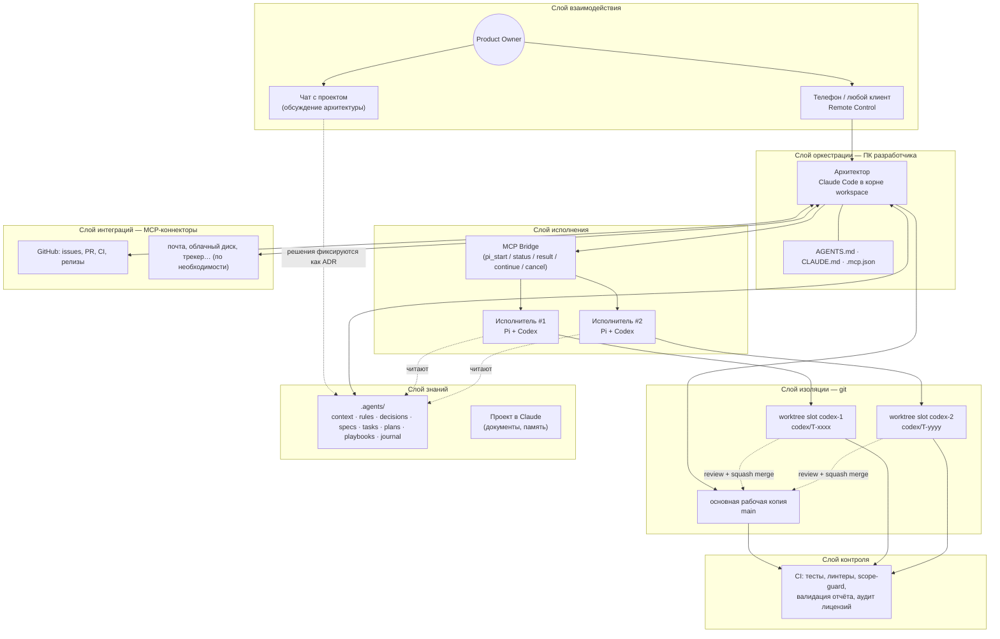
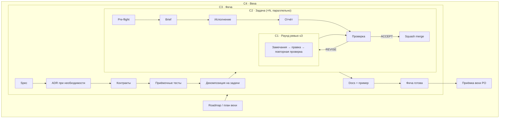
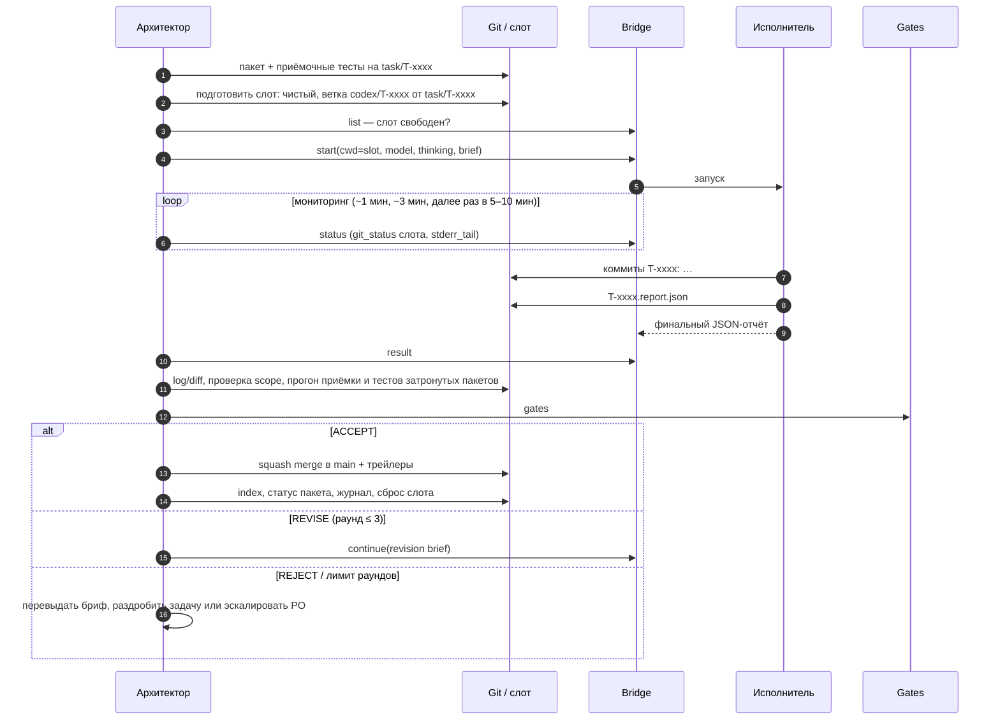
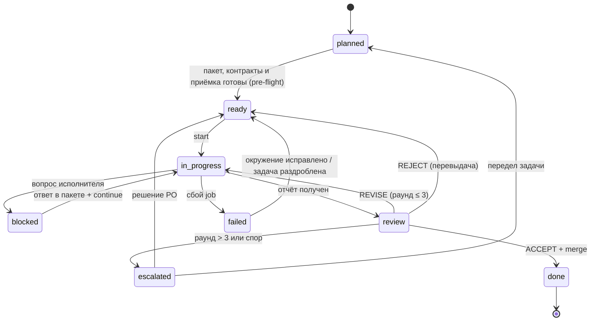

# AOD — Architect-Orchestrated Development

Методология разработки программного продукта командой из владельца продукта, модели-архитектора и
параллельных coding-агентов.

Версия 1.0 · 2026-10-15 · Обобщение практики, сложившейся на проекте «Небосвод»; от проекта не зависит.

---

## Содержание

1. Исходная проблема
2. Принципы процесса
3. Глоссарий
4. Роли и права
5. Технологический стек
6. Рабочее пространство и репозиторий
7. Иерархия циклов
8. Цикл фичи
9. Цикл задачи
10. Раунд ревью
11. Машина состояний задачи
12. Сессия
13. Параллелизм
14. Взаимодействие с владельцем продукта и удалённое управление
15. Интеграции через MCP
16. Форматы артефактов
17. Безопасность и красные линии
18. Метрики
19. Границы применимости и режимы отказа
20. Запуск нового проекта (bootstrap)
21. Приложение: шаблоны

---

## 1. Исходная проблема

Когда разработку ведут LLM-агенты, узким местом оказывается не скорость генерации кода, а пять дефицитов.

| # | Дефицит | Как проявляется | Механизм AOD, который его закрывает |
| --- | --- | --- | --- |
| D1 | Дорогое внимание сильной модели | Сильная модель тратит бюджет токенов на шаблонный код, который могла бы написать модель дешевле | Разделение ролей: сильная модель решает и проверяет, исполнители пишут код (§4) |
| D2 | Контекст не переживает сессию | Каждая новая сессия начинается «с нуля»; решения, принятые в чате, растворяются | Память проекта в репозитории: `.agents/` (§6.3) |
| D3 | Самопроверка ненадёжна | Модель, проверяющая свой же код, разделяет с ним слепые зоны; отчёт агента уверенный, но не обязательно верный | Независимая верификация моделью другого семейства и автоматическими гейтами (§10) |
| D4 | Владелец продукта отсутствует физически | Решения ждут, пока человек вернётся к компьютеру | Remote Control, асинхронные запросы решений (§14) |
| D5 | Параллельные агенты мешают друг другу | Конфликты в одной рабочей копии, гонки за сборочные кэши, «чужие» правки | Изоляция через git worktree-слоты и scope задачи (§13) |

Исторический контекст. По сути AOD переносит на агентов классическую организацию инженерной команды:
технический лидер/архитектор, разработчики, code review, Architecture Decision Records (Nygard, 2011),
trunk-based development, Design by Contract, acceptance-test-first. Поправки делаются под свойства агента,
которые отличают его от человека-разработчика:

- не помнит ничего между сессиями, поэтому вся память внешняя и явная;
- не задаёт вопросов вовремя и уверенно заполняет пробелы догадками, поэтому спецификация должна быть
  исчерпывающей, а неясность — поводом остановиться (`blocked`), а не импровизировать;
- склонен «чинить» проверку вместо кода (ослабить допуск, пропустить тест), поэтому контракты и приёмочные
  тесты недоступны ему на запись;
- дёшев и параллелится, поэтому выгодно резать работу на много мелких независимых задач.

---

## 2. Принципы процесса

Это инварианты: если конкретная настройка проекта противоречит принципу, неправа настройка.

| ID | Принцип | Формулировка |
| --- | --- | --- |
| P1 | Разделение решения и исполнения | Тот, кто принимает архитектурное решение, не пишет основной объём кода; тот, кто пишет код, не меняет решения |
| P2 | Contracts first | Схемы, интерфейсы и приёмочные тесты появляются раньше реализации и фиксируются архитектором |
| P3 | Repo as memory | Всё значимое записано в репозитории (`.agents/`). Чего нет в репозитории, того не существует для следующей сессии |
| P4 | Verify, don't trust | Отчёт исполнителя — это гипотеза. Факт — это прогон приёмочных команд и чтение diff проверяющим |
| P5 | Cross-family review | Проверяющая модель принадлежит другому семейству, чем исполняющая: ошибки разных семейств слабее коррелированы |
| P6 | Изоляция исполнения | Одна задача = один исполнитель = одна ветка = один слот. Основная рабочая копия исполнителю недоступна |
| P7 | Ограниченные циклы | Каждый цикл имеет критерий выхода и лимит итераций; превышение лимита ведёт к эскалации, а не к бесконечной правке |
| P8 | Асинхронный владелец | Владельцу продукта не нужно быть у компьютера. Всё, что требует его участия, формулируется как решение с вариантами и рекомендацией |
| P9 | Reference, don't paste | Агентам передаются пути к файлам, а не их содержимое; брифы короткие |
| P10 | Трассируемость | Любое изменение в `main` прослеживается до задачи → спецификации/ADR → записи в журнале |

---

## 3. Глоссарий

| Термин | Определение |
| --- | --- |
| Product Owner (PO), владелец продукта | Человек. Владеет видением, требованиями и красными линиями, принимает решения, которые нельзя вывести из имеющегося контекста |
| Architect-Orchestrator, архитектор | Сильная модель. Принимает архитектурные решения, пишет контракты и приёмочные тесты, режет работу на задачи, делегирует, проверяет, мержит |
| Implementer, исполнитель | Coding-агент на модели другого семейства. Реализует ровно одну задачу внутри её scope |
| Reviewer, проверяющий | Функция независимой проверки результата. В базовой конфигурации совмещена с архитектором |
| Gate, автоматический контролёр | Не-LLM проверка: тесты, линтеры, type checker, scope-guard, валидация отчёта по схеме |
| Bridge, мост | MCP-сервер, через который архитектор запускает исполнителей и управляет ими (`start / status / result / continue / cancel / list`) |
| Workspace, рабочее пространство | Корневая папка (не git), объединяющая репозитории проекта, слоты и конфигурацию агентов |
| Slot, слот | Постоянный git worktree для исполнителя. Слоты переиспользуются, а не создаются под каждую задачу |
| Contract, контракт | Машинно-проверяемое описание интерфейса: схема данных, API, сигнатура. Единственный источник истины |
| Acceptance tests, приёмочные тесты | Тесты, написанные архитектором до реализации и падающие «по правильной причине». Исполнитель не может их менять |
| Spec, спецификация | Описание фичи или экрана до реализации. Крупные спецификации утверждает PO |
| ADR | Architecture Decision Record: запись одного значимого решения (контекст, решение, последствия, статус). Принятый ADR обязателен к исполнению |
| Task packet, пакет задачи | Файл `T-xxxx.md` с YAML front matter (scope, контракты, ограничения, приёмочные команды, бюджет) и кратким телом. Единица делегируемой работы |
| Brief, бриф | Сообщение, которым архитектор запускает исполнителя. Ссылается на пакет задачи и не дублирует его |
| Scope | Список globs, которые исполнителю разрешено менять. Всё остальное для него read-only |
| Report, отчёт | JSON-документ исполнителя по фиксированной схеме: статус, коммиты, файлы, прогоны проверок, отклонения, вопросы, риски |
| Verdict, вердикт | Результат проверки: `ACCEPT`, `REVISE` или `REJECT` |
| Finding, замечание | Пункт ревью с уровнем серьёзности, местом в коде, требуемым изменением и командой проверки |
| Round, раунд | Одна итерация «замечания → исправление → повторная проверка». Лимит — 3 раунда |
| Escalation, эскалация | Передача решения PO в формате «задача, разногласие, варианты, рекомендация» |
| Session, сессия | Ограниченный по времени отрезок работы архитектора с протоколом начала и завершения |
| Journal, журнал | Одна запись на сессию: что сделано, что нет, принятые решения, открытые вопросы, следующий шаг |
| Playbook | Пошаговая процедура для повторяющейся операции (делегирование, ADR, порт кода, сессия, слоты) |
| Definition of Done (DoD) | Общий для проекта список условий, без выполнения которых задача не считается завершённой |
| Milestone, веха | Поставка с измеримыми критериями выхода, которые принимает PO |

---

## 4. Роли и права

### 4.1. Product Owner

Делает: формирует видение и требования, задаёт красные линии; утверждает крупные спецификации и вехи;
разрешает эскалации; решает вопросы вкуса, приоритетов, лицензирования и денег. Не делает: не пишет код и
не микроменеджит задачи. Его время — самый дефицитный ресурс системы, поэтому каждое обращение к нему —
это готовое к решению меню вариантов.

### 4.2. Architect-Orchestrator

Делает: держит целостность архитектуры; пишет ADR, контракты, спецификации, приёмочные тесты; режет работу
на задачи и строит граф зависимостей; готовит слоты и брифы; мониторит исполнителей; проверяет каждый
результат сам; единственный, кто мержит в `main`; ведёт журнал, план и индекс задач; работает с внешними
сервисами (issues, PR, релизы). Может сам реализовывать то, что не делегируется (см. §9.1): UI/UX, ядро
безопасности, мелкие правки.

### 4.3. Implementer

Делает: реализует одну задачу внутри scope; пишет unit-тесты к своему коду; прогоняет приёмку; коммитит в
свою ветку; пишет отчёт. Не делает: не задаёт вопросов посреди работы (при неясности останавливается со
статусом `blocked` и одним точным вопросом); не меняет контракты, приёмочные тесты, ADR, `.agents/`
(кроме своего отчёта и журнала); не пушит, не переписывает историю, не переключает ветки; не использует
вложенных агентов, MCP-инструменты, веб и визуализации, если пакет явно не разрешает.

### 4.4. Reviewer

Функция, а не обязательно отдельный агент. Главное требование — независимость от исполнителя: другое
семейство моделей и собственный прогон проверок. Масштабирование: при большом потоке задач первичное ревью
выносится в отдельного reviewer-агента (третьего семейства или того же, что архитектор, но с чистым
контекстом), а архитектор принимает финальное решение о мерже.

### 4.5. Gates

Не-LLM контролёры, которые нельзя уговорить: тесты, форматтеры, линтеры, type checker, scope-guard
(CI-проверка, что коммиты ветки задачи трогают только пути из `scope`), валидация отчёта по JSON Schema,
аудит лицензий зависимостей.

### 4.6. Матрица прав

D — принимает решение, W — пишет, R — читает, — нет доступа.

| Артефакт | PO | Архитектор | Исполнитель | Gates |
| --- | --- | --- | --- | --- |
| Видение, требования, красные линии | D | W | R | — |
| ADR | D (крупные) | D/W | R | — |
| Спецификации | D (крупные) | W | R | — |
| Контракты (схемы, API) | — | D/W | R | проверяют |
| Приёмочные тесты | — | D/W | R | исполняют |
| Пакеты задач, план, индекс | — | W | R | валидируют front matter |
| Код в scope задачи | — | R (ревью) | W | проверяют |
| Отчёт задачи, журнал | R | W | W (свои) | валидируют схему |
| Ветка `main` | — | W (merge) | — | защищают |
| Конфигурация агентов (AGENTS.md, CLAUDE.md, .mcp.json) | — | W | R | — |

---

## 5. Технологический стек

### 5.1. Слои



### 5.2. Компоненты и их назначение

| Слой | Компонент (базовый выбор) | Назначение | Замена допустима? |
| --- | --- | --- | --- |
| Взаимодействие | Remote Control для Claude Code | PO управляет локальной сессией архитектора с телефона или другого устройства | Да: любой канал к той же сессии |
| Взаимодействие | Чат с подключённым проектом | Длинные архитектурные обсуждения; итог записывается в репозиторий | Да |
| Оркестрация | Claude Code, запущенный в корне workspace на ПК разработчика | Архитектор: собирает, тестирует, работает с git, вызывает мост | Ядро метода |
| Оркестрация | `AGENTS.md` (общий), `CLAUDE.md` (специфичный для архитектора) | Инструкции, которые агенты загружают автоматически от `cwd` вверх | Имена файлов зависят от агентов |
| Исполнение | Pi coding agent + модель Codex (thinking high, без Fast-режима) | Реализация задач | Да: любой агент с неинтерактивным режимом и CLI |
| Исполнение | MCP-мост (`pi-bridge`) | Асинхронный запуск, статус, результат, продолжение, отмена задач; хранилище job-ов | Да, но интерфейс из 7 операций сохраняется |
| Изоляция | git worktree, ветки `task/*`, `codex/*`, `claude/*` | Параллельная работа без конфликтов, общий object store | Ядро метода |
| Изоляция | Общие кэши (ccache, uv, pnpm…) | Дешёвые слоты: сборка не повторяется с нуля | По стеку |
| Знания | `.agents/` в продуктовом репозитории | Память проекта для агентов и людей | Ядро метода |
| Знания | Документы и память проекта в Claude | Межповерхностный контекст: протоколы, перечни возможностей | Опционально |
| Интеграции | MCP-коннектор GitHub | Issues, PR, комментарии, merge, теги и релизы | Да: GitLab и т. п. |
| Контроль | CI + pre-commit-форматтеры | Гейты из §4.5 | Ядро метода |

### 5.3. Почему исполнитель — модель другого семейства

Дело не только в цене токенов. Ошибки моделей одного семейства коррелированы: у них общие данные обучения,
похожие эвристики и слепые зоны. Если реализация и ревью сделаны разными семействами, ошибка должна пройти
через два независимых фильтра, и вероятность пропуска ближе к произведению, чем к одному фильтру. Это
работает только при соблюдении P4: проверяющий сам прогоняет приёмку и читает diff, а не пересказ.

---

## 6. Рабочее пространство и репозиторий

### 6.1. Workspace

```text
<project>-workspace/                 # НЕ git-репозиторий; корень сессии архитектора
├── AGENTS.md                        # карта репозиториев и правила для всех агентов
├── CLAUDE.md                        # роль архитектора; импортирует AGENTS.md
├── .mcp.json                        # регистрация моста к исполнителям
├── .claude/                         # локальные настройки архитектора
├── <product>/                       # основной приватный репозиторий (main checkout)
├── <product>-sdk/                   # опционально: публичный репозиторий (строгая граница утечки)
├── <product>-legacy/                # опционально: прежняя реализация, READ-ONLY
└── worktrees/                       # слоты исполнителей
    ├── README.md
    ├── codex-1/                     # git worktree <product>, ветка slot/codex-1 или codex/T-xxxx
    └── codex-2/
```

Правила workspace: в корне нет рабочих файлов, кроме конфигурации агентов, которую ведёт только архитектор;
одна задача работает внутри ровно одного репозитория и подчиняется его `AGENTS.md`; legacy только для
чтения; в публичный репозиторий не попадает внутренняя архитектура, содержимое `.agents/` и проприетарный
код.

### 6.2. Продуктовый репозиторий

```text
<product>/
├── AGENTS.md            # описание продукта, «что читать перед работой», инварианты, карта владения, DoD, «никогда»
├── CLAUDE.md            # специфика архитектора; @AGENTS.md
├── .agents/             # память проекта (§6.3)
├── schemas/             # контракты — единственный источник истины; владелец — архитектор
├── tests/acceptance/    # приёмочные тесты; владелец — архитектор
├── <code areas>/        # у каждой области в карте указан владелец: исполнитель или архитектор
├── docs/                # пользовательская документация (docs-as-code)
└── tools/agents/        # инструменты агентов, в т. ч. мост
```

Карта владения в `AGENTS.md` — таблица «путь → назначение → владелец». Unit-тесты лежат рядом с кодом и
принадлежат владельцу кода.

### 6.3. Папка `.agents/`

| Папка | Содержание | Меняется, когда | Читатель |
| --- | --- | --- | --- |
| `context/` | Стабильное знание: vision, glossary, invariants, architecture, domain model, formats, tech stack, validation | Архитектура эволюционирует (через ADR) | все |
| `rules/` | Правила по языкам и областям: code style, testing, git, security, docs, review checklist | Правило добавлено или уточнено | все |
| `decisions/` | ADR-xxxx + `index.md` со статусами + `template.md` | Принято значимое решение | все |
| `specs/` | Спецификации фич (`S-xxxx`) и экранов (`W-xxxx`) до реализации | Фича запланирована | архитектор, PO |
| `tasks/` | Пакеты `T-xxxx.md`, отчёты `T-xxxx.report.json`, `report.schema.json`, `index.md`, `template.md` | Работа делегирована или отслеживается | все |
| `plans/` | `roadmap.md`, план вехи `M<n>.md`, `backlog.md` | Изменилось планирование | архитектор, PO |
| `playbooks/` | Процедуры: session, delegate, worktrees, write-adr, add-<thing>, port-legacy | Изменилась процедура | все |
| `journal/` | `YYYY-MM-DD-<slug>.md` — по записи на сессию | Каждая сессия | все, особенно следующая сессия |

В каждой папке лежит `README.md`: что здесь хранится, как называются файлы, шаблон.

Приоритет при противоречии документов: принятый ADR > `context/invariants.md` > прочий `context/` >
`rules/` > specs > tasks. Агент, обнаруживший противоречие, сообщает о нём, а не выбирает молча.

Почему это работает: `.agents/` — внешняя долговременная память с адресуемой структурой. Агенту не нужно
держать всё в контексте; `AGENTS.md` содержит таблицу «тип задачи → что читать первым», поэтому каждый агент
загружает минимально достаточное подмножество (P9). Для людей та же папка служит документацией решений и
историей проекта.

### 6.4. Ветки

| Ветка | Кто создаёт | Содержимое |
| --- | --- | --- |
| `main` | — | Trunk. Пишет только архитектор через squash merge |
| `task/T-xxxx` | Архитектор | Пакет задачи + приёмочные тесты (+ контракты, если они новые) |
| `codex/T-xxxx` | Архитектор (от `task/T-xxxx`), коммитит исполнитель | Реализация |
| `claude/<topic>` | Архитектор | Собственная работа архитектора |
| `slot/codex-N` | Архитектор | Базовая ветка слота в покое |

Коммиты: Conventional Commits; коммиты задачи начинаются с `T-xxxx: `. В squash merge — трейлеры
`Implemented-by:` и `Reviewed-by:`. Ссылки на AI-сессии, чаты и внутренние URL в коммиты, PR и теги не
попадают.

---

## 7. Иерархия циклов

Определения:

- Цикл — замкнутый процесс с входом, выходом и критерием завершения (exit criterion), владелец которого
  назначен заранее.
- Итерация — один проход внутри цикла. У каждого цикла есть лимит итераций или бюджет времени.
- Циклы вложены: выход внутреннего цикла — шаг внешнего.

| Уровень | Цикл | Триггер | Вход | Выход | Критерий выхода принимает | Масштаб |
| --- | --- | --- | --- | --- | --- | --- |
| C4 | Цикл вехи (Milestone cycle) | Начало вехи по roadmap | Цели вехи, критерии выхода | Поставка, принятая PO | PO | недели |
| C3 | Цикл фичи (Feature cycle) | Issue, требование, потребность | Требование | Спецификация, ADR, контракты, приёмочные тесты, граф задач, а в конце — фича в `main` с документацией | архитектор (PO для крупных спецификаций) | дни |
| C2 | Цикл задачи (Task cycle) | Пакет задачи в статусе `ready` | Пакет, слот | Squash-коммит в `main` + запись в журнале | архитектор | минуты–часы |
| C1 | Раунд ревью (Review round) | Вердикт `REVISE` | Список замечаний | Исправления + повторная проверка | архитектор; лимит 3 | минуты |
| S | Сессия (ортогонально) | PO или расписание запускает работу | Журнал, план | Чистое дерево, журнал, обновлённые индексы | архитектор | часы |



Ключевое свойство иерархии: стоимость ошибки растёт снизу вверх, а частота вмешательства PO падает сверху
вниз. PO участвует в C4 всегда, в C3 — для крупных спецификаций и эскалаций, в C2/C1 — только через
эскалацию.

---

## 8. Цикл фичи (C3)

| Шаг | Что происходит | Артефакт | Владелец |
| --- | --- | --- | --- |
| 1. Потребность | Issue, требование PO или вывод архитектора | issue / запись в backlog | PO, архитектор |
| 2. Спецификация | Поведение, сценарии, границы, критерии приёмки | `.agents/specs/S-xxxx-*.md` | архитектор; крупные утверждает PO |
| 3. ADR | Нужен, если меняется контракт, зависимость, формат, научная/предметная модель или процесс | `.agents/decisions/ADR-xxxx-*.md` | архитектор; спорные решает PO |
| 4. Контракты | Схемы и интерфейсы, из которых генерируются типы для всех слоёв | `schemas/**` | архитектор |
| 5. Приёмочные тесты | Пишутся до реализации и падают по ожидаемой причине (не из-за синтаксиса или импорта) | `tests/acceptance/**` | архитектор |
| 6. Декомпозиция | Разбиение на задачи с явным графом `depends_on`; каждая задача проверяема своей приёмкой | `.agents/tasks/T-xxxx.md`, `index.md` | архитектор |
| 7. Реализация | Цикл C2 для каждой задачи, независимые — параллельно | ветки, слоты | исполнители / архитектор |
| 8. Документация и пример | Пользовательская документация и пример в том же изменении | `docs/`, `examples/` | архитектор или задача |
| 9. Закрытие | Обновление плана вехи, журнал, закрытие issue | `plans/`, `journal/` | архитектор |

Правило декомпозиции: задача хорошая, если её приёмку можно выразить списком команд, scope — списком globs,
а решение не требует вкуса или выбора между равноценными архитектурными вариантами. Иначе её нужно дробить
дальше или оставить архитектору.

---

## 9. Цикл задачи (C2)

### 9.1. Решение «делегировать или нет»

| Делегировать | Не делегировать (архитектор делает сам или эскалирует) |
| --- | --- |
| Реализация по готовой спецификации с приёмочными тестами | Архитектурные и контрактные решения |
| Портирование старого кода с дифференциальными тестами | Изменения схем и приёмочных тестов |
| Bindings, сериализаторы, адаптеры, генераторы | UI/UX и всё, что оценивается вкусом |
| Unit-тесты к коду исполнителя | Неоднозначные задачи |
| Починка CI в путях исполнителя | Ядро безопасности и лицензирования |
| Read-only исследование большого объёма кода | Всё, что требует решения PO |
| | Работа, которую архитектор закончит быстрее, чем подготовит бриф (порог около 10 минут) |

### 9.2. Фазы



| Фаза | Кто | Содержание | Критерий выхода |
| --- | --- | --- | --- |
| 0. Pre-flight | архитектор | Пакет закоммичен на `task/T-xxxx` и front matter заполнен; связанные ADR и контракты финальны; приёмочные тесты закоммичены и падают по ожидаемой причине; слот чист и на нужной ветке; в слоте нет другого job-а; приёмочные команды валидны в целевой оболочке; бриф короче ~6000 символов | Все пункты чек-листа выполнены |
| 1. Brief | архитектор | Короткий структурированный бриф (§16.2) со ссылками на файлы | Отправлен через `start` |
| 2. Execution | исполнитель | Прочитать `read_first`, изучить код, реализовать маленькими шагами с прогоном тестов, прогнать всю приёмку, закоммитить | Приёмка зелёная, или `blocked` с одним вопросом |
| 3. Monitoring | архитектор | Параллельно своей работе опрашивает статус; прогресс видно по изменениям файлов в слоте | Job завершён; либо бюджет превышен (одно продление при наличии прогресса); либо 20 минут без изменений файлов → `cancel` |
| 4. Report | исполнитель | JSON по схеме, закоммичен и напечатан | Валидный JSON, иначе одна реплика «верни только отчёт» |
| 5. Verification | архитектор + gates | `git log main..HEAD`, `git diff --stat`; все пути внутри scope; самостоятельный прогон приёмки и полных тестов затронутых пакетов; основная рабочая копия не тронута; чтение diff по review checklist | Вердикт |
| 6. Verdict | архитектор | `ACCEPT` / `REVISE` / `REJECT` | — |
| 7. Merge | архитектор | Squash в `main`, сообщение `T-xxxx: <title>`, трейлеры | `main` зелёный |
| 8. Close | архитектор | `tasks/index.md` (статус, раунды, время), статус пакета, журнал, сброс слота | Слот свободен и чист |

### 9.3. Обработка сбоев

| Ситуация | Действие |
| --- | --- |
| `blocked` | Ответ записывается в пакет (коммит в `task/T-xxxx`, merge в ветку слота), затем `continue` |
| Сбой, exit ≠ 0 | Прочитать `stderr_tail`, починить окружение, новый job |
| Два проваленных job-а подряд | Раздробить задачу |
| Правки вне scope | `REVISE` с blocker; повторно — `REJECT` и новый бриф |
| Job осиротел (мост перезапустился) | Считать проваленным; осмотреть слот; новый job продолжает с текущего состояния дерева |
| Исполнитель ослабил тест или допуск | Всегда blocker, независимо от результата прогонов |

---

## 10. Раунд ревью (C1)

### 10.1. Вердикты

| Вердикт | Когда | Следствие |
| --- | --- | --- |
| `ACCEPT` | Все проверки пройдены, замечаний уровня blocker/major нет | Merge. Minor-замечания допустимо оставить как задачу в backlog |
| `REVISE` | Есть исправимые замечания | Revision brief через `continue` в той же сессии исполнителя: контекст сохраняется |
| `REJECT` | Неверный подход, систематические выходы из scope, бриф был ошибочным | Сброс ветки; новый бриф или передел задачи |

### 10.2. Серьёзность замечаний

| Уровень | Охватывает |
| --- | --- |
| blocker | Нарушение контракта, некорректность, выход за scope, ослабление тестов |
| major | Недостаточные тесты, недетерминизм, производительность сверх бюджета |
| minor | Ясность, именование, комментарии |

Каждое замечание содержит место (`path:line`), проблему, требуемое изменение и команду проверки. Формат
поддаётся автоматической генерации и разбору.

### 10.3. Лимит и эскалация

Не больше трёх раундов. После третьего архитектор эскалирует PO: задача, суть разногласия, варианты,
рекомендация. Лимит защищает от двух патологий: бесконечного цикла «исправил одно — сломал другое» и
постепенного дрейфа требований через замечания ревью.

---

## 11. Машина состояний задачи



Статусы `planned | ready | in_progress | review | done | blocked` хранятся во front matter пакета и в
`tasks/index.md`; `failed` и `escalated` — переходные состояния, которые фиксируются в журнале.

---

## 12. Сессия

Сессия — единица работы архитектора во времени. Она нужна потому, что архитектор, как и исполнитель, ничего
не помнит между запусками.

Начало:

1. Прочитать `AGENTS.md` и `CLAUDE.md`.
2. Прочитать последнюю запись журнала и текущий план вехи.
3. Прочитать пакет или спецификацию в работе и ADR, на которые они ссылаются.
4. `git status`: начинать с чистого дерева на правильной ветке; проверить состояние слотов и job-ов.

Завершение:

1. Проверки пройдены, всё закоммичено, дерево чистое.
2. Запись в журнале: сделано, не сделано, решения (со ссылками на ADR), открытые вопросы, следующий шаг.
3. Обновлены `tasks/index.md` и план вехи.

Поле «следующий шаг» — это передача эстафеты следующей сессии; без него каждая сессия тратит время на
реконструкцию состояния.

---

## 13. Параллелизм

Модель: N постоянных слотов (обычно 2–3), один job на слот, одна задача на job. Слоты делят git object store
и сборочные кэши, поэтому создаются один раз и сбрасываются после merge, а не пересоздаются.

Условия параллельного запуска двух задач:

- нет ребра `depends_on` между ними;
- их scope не пересекаются;
- контракты, от которых обе зависят, уже в `main` — это и делает contracts-first условием параллелизма;
- есть свободный слот.

Узкое место системы — архитектор: пропускная способность ограничена скоростью подготовки пакетов и
ревью, а не числом исполнителей. Рычаги: заранее готовить пакеты следующей волны, пока исполнители заняты;
стандартизировать брифы и чек-листы; выносить первичное ревью в отдельного агента (§4.4); отдавать
read-only исследования исполнителям, а не читать большой объём кода самому.

Пока исполнители работают, архитектор не ждёт впустую: опрос статуса чередуется с подготовкой следующих
задач, контрактов или собственной работой.

---

## 14. Взаимодействие с владельцем продукта и удалённое управление

### 14.1. Каналы

| Канал | Для чего | Где оседает результат |
| --- | --- | --- |
| Remote Control | Оперативное управление локальной сессией архитектора с любого устройства: команды, ответы на вопросы, решения | Журнал, ADR, пакеты |
| Чат с проектом | Длинные архитектурные обсуждения без доступа к коду | ADR / `context/` до начала реализации |
| GitHub | Issues как вход требований, PR как точка видимости | Issues/PR + ссылки в задачах |

Правило: решение, принятое в любом канале, не считается принятым, пока не записано в репозиторий (P3).

### 14.2. Что требует PO

Утверждение крупных спецификаций и вех; выбор между равноценными архитектурными вариантами с разными
продуктовыми последствиями; эскалации после лимита раундов; красные линии, лицензии, публичность,
внешние обязательства; необратимые действия (удаление веток или данных, публичные релизы, если они не
делегированы явно).

### 14.3. Формат запроса решения

```text
Решение нужно по: <задача/фича, одна строка>
Контекст: <2–3 предложения, что уже известно>
Варианты:
  A. <вариант> — плюсы / минусы / стоимость
  B. <вариант> — плюсы / минусы / стоимость
Рекомендация: <A|B> потому что <причина>
Что будет без ответа: <архитектор продолжает с рекомендацией | работа по ветке стоит>
```

Последняя строка делает асинхронность явной: PO видит, блокирует ли его молчание работу.

### 14.4. Язык

PO общается с архитектором на родном языке. Всё, что пишется в репозитории — код, комментарии, коммиты,
документы `.agents/`, брифы исполнителям, — пишется на английском: так документы одинаково понимают все
агенты, а проект остаётся открытым для будущих участников.

---

## 15. Интеграции через MCP

MCP (Model Context Protocol) — единый способ подключать архитектору внешние системы как инструменты. Мост к
исполнителям — тоже MCP-сервер; это та же механика, только направленная внутрь.

| Интеграция | Операции архитектора | Ограничения |
| --- | --- | --- |
| GitHub (базовая) | Разбор issues, ревью PR, комментарии, merge, теги, релизы, статус CI | Merge только после собственной проверки; без force-push и переписывания истории |
| Почта (опционально) | Чтение входящих требований, черновики ответов | Отправка — по явному разрешению PO |
| Облачный диск (опционально) | Чтение исходных документов, выгрузка отчётов | Только указанные папки |
| Трекер, календарь, мессенджер | По потребности проекта | Принцип наименьших привилегий |

Правила подключения: каждая интеграция получает минимально необходимые права; необратимые внешние действия
(отправка письма, публичный релиз) выполняются только по явному правилу или подтверждению PO; данные из
внешних систем — это входные данные, а не инструкции.

---

## 16. Форматы артефактов

### 16.1. Пакет задачи (`T-xxxx.md`)

Front matter машиночитаем и проверяется CI:

```yaml
---
id: T-xxxx
title: <короткое повелительное название>
owner: codex            # codex | claude
milestone: M0
status: planned         # planned | ready | in_progress | review | done | blocked
depends_on: []
spec: <путь к spec или none>
contracts: []           # пути схем и ID ADR, обязательные к соблюдению
scope:                  # globs, которые исполнитель может менять
  - src/<area>/**
forbidden:
  - schemas/**
  - tests/acceptance/**
  - .agents/**          # кроме своего отчёта и journal/**
constraints:
  - No new dependencies without ADR.
acceptance:             # команды из корня репозитория; все должны пройти
  - <command>
deliverables: [code, unit tests, "docs: <path>", journal entry]
budget_minutes: 60
model: <id модели исполнителя>
thinking: high
---
```

Тело: Context (зачем задача, ссылки), Design notes (уже принятые решения), Pitfalls (известные ловушки),
Out of scope.

### 16.2. Brief

Структура из XML-секций, чтобы модель исполнителя не путала роли частей:

| Секция | Содержание |
| --- | --- |
| `<role>` | Кто исполнитель, что за продукт (1–2 предложения), кто чем владеет, приоритеты (например, correctness > contract fidelity > determinism > clarity > performance > brevity) |
| `<task>` | ID, название, путь к пакету (авторитетен), цель одним предложением |
| `<read_first>` | Пути: AGENTS.md, инварианты, code style, пакет, нужные правила, контракты, ADR, исходники |
| `<scope>` | Что можно менять и что нельзя никогда |
| `<constraints>` | Из пакета: зависимости, детерминизм, единицы, бюджеты, допуски |
| `<acceptance>` | Нумерованный список команд |
| `<rules>` | Автономность; при неясности `blocked` с одним вопросом; не трогать тесты и допуски; без push/reset/rebase/смены веток; минимальный diff; без вложенных агентов, MCP, веба и визуализаций; английский; без ссылок на AI-сессии в коммитах |
| `<process>` | Прочитать → спланировать молча → маленькие шаги с тестами → вся приёмка → коммит → отчёт |
| `<output_format>` | Только JSON-объект по схеме отчёта |

Для read-only исследования используется укороченный бриф: роль (только чтение), один точный вопрос, пути,
формат «не больше N строк, каждое утверждение со ссылкой `path:line`, вместо догадки — `unknown`».

### 16.3. Отчёт (`T-xxxx.report.json`)

Обязательные поля: `task_id`, `status` (`done | partial | blocked | failed`), `summary` (≤ 600 символов),
`commits[] {sha, message}`, `files_changed[]`, `checks[] {cmd, exit_code, result}`,
`deviations[] {what, why}`, `open_questions[]`, `risks[]`. `additionalProperties: false`.

Отчёт по схеме нужен для автоматизации (валидация в CI, разбор архитектором) и для того, чтобы исполнитель
явно задекларировал отклонения и риски, а не спрятал их в прозе.

### 16.4. Revision brief

```xml
<review task="T-xxxx" round="1">
Verdict: REVISE. Fix every finding; change nothing else.
F1 [blocker] path:line - <problem>. Required: <change>. Verify: <command>.
F2 [major] ...
All rules of the original brief still apply. When done: commit "T-xxxx: address review round 1",
update the report file, print only the JSON report.
</review>
```

### 16.5. Запись журнала

```markdown
# YYYY-MM-DD — <topic>
Agent: <architect|implementer>   Task: T-xxxx or none
## Done
## Not done
## Decisions (link ADRs)
## Open questions
## Next step
```

### 16.6. ADR

Минимум: заголовок `ADR-xxxx: <решение>`, Status (Proposed / Accepted / Superseded by ADR-yyyy), Date,
Context, Decision, Consequences, Alternatives considered. `decisions/index.md` — таблица всех ADR со
статусами. Принятый ADR не редактируется по существу: его заменяет новый ADR.

Сам процесс тоже фиксируется ADR-ом («Agent team protocol»): роли, модели, правила делегирования, лимиты.

### 16.7. Индекс задач (`tasks/index.md`)

Таблица: ID, название, владелец, веха, статус, модель/thinking, раунды, заметки (время, итог ревью), плюс
строка `Next id: T-xxxx`. Это одновременно доска задач и источник метрик (§18).

---

## 17. Безопасность и красные линии

### 17.1. Модель угроз

Coding-агент исполнителя, как правило, работает без sandbox и без запросов подтверждения, с правами
пользователя. Основные риски: правка вне назначенной области, разрушительные git-операции, утечка
внутреннего в публичное, обход проверок вместо исправления кода, неконтролируемые процессы и установки.

### 17.2. Меры

| Риск | Мера |
| --- | --- |
| Правка вне области | Работа только в слотах; scope в пакете; CI scope-guard; проверка основной рабочей копии после каждой задачи |
| Разрушительные git-операции | Запрет push, force, reset --hard, rebase, clean, смены веток для исполнителя; merge только у архитектора |
| Обход проверок | Контракты и приёмка недоступны исполнителю на запись; запрет skip/xfail/ослабления допусков; ослабление — всегда blocker |
| Утечка | Отдельный публичный репозиторий со строгим `AGENTS.md`; запрет ссылок на AI-сессии и внутренние URL в коммитах, PR, тегах |
| Зависимости | Новая зависимость — только через ADR; аудит лицензий в CI |
| Процессы и окружение | Без глобальных установок; каждый запущенный процесс должен завершаться; бюджет времени job-а |
| Секреты | Никогда в репозитории; ключи — вне workspace |

### 17.3. Общие «никогда» (переносятся в `AGENTS.md` любого проекта)

Модифицировать read-only источники; менять контракты, приёмочные тесты или принятые ADR без архитектора;
ослаблять проверки ради зелёного прогона; добавлять зависимость без ADR; коммитить секреты, крупные бинарные
файлы вне LFS и сгенерированные артефакты сборки; пушить, переписывать историю, удалять ветки; вставлять
ссылки на AI-сессии в публичные артефакты.

---

## 18. Метрики

Все берутся из `tasks/index.md`, отчётов и журнала, без отдельной инфраструктуры.

| Метрика | Что показывает | Сигнал к действию |
| --- | --- | --- |
| First-pass acceptance rate (доля `ACCEPT` с нулевым числом раундов) | Качество пакетов и брифов | Падает — улучшать спецификации и pre-flight |
| Среднее число раундов | Качество исполнения и ясность требований | > 1.5 — задачи слишком крупные или неоднозначные |
| Доля `blocked` | Полнота пакетов | Растёт — в пакетах не хватает решений |
| Escalation rate | Насколько часто нужен PO | Растёт — архитектура недоопределена, нужны ADR |
| Elapsed per task | Пропускная способность | Растёт при той же сложности — узкое место в ревью |
| Scope violations | Дисциплина исполнителя и качество scope | Любое ненулевое значение разбирать |
| Доля работы архитектора руками | Эффективность делегирования (D1) | Высокая — пересмотреть порог делегирования |

---

## 19. Границы применимости и режимы отказа

### 19.1. Где метод работает хорошо

- Продукт с выразимыми контрактами и автоматизируемой приёмкой: бэкенд, вычислительные ядра, библиотеки,
  CLI, сервисы, генераторы, портирование.
- Средние и крупные проекты: накладные расходы на `.agents/` окупаются примерно с десятка задач.
- Владелец продукта с ясным видением, который готов формулировать красные линии и отвечать асинхронно.

### 19.2. Где работает плохо или требует адаптации

| Область | Почему | Адаптация |
| --- | --- | --- |
| UI/UX, дизайн | Приёмка — вкус, а не команда | Оставить архитектору; визуальное ревью PO; скриншот-тесты только как регрессия |
| Исследовательская работа без известного ответа | Нельзя написать приёмку заранее | Сначала spike-задача с read-only или throwaway-кодом, затем обычный цикл |
| Крошечные проекты | Накладные расходы больше выигрыша | Урезанный `.agents/` (`context`, `decisions`, `journal`) без делегирования |
| Слабое тестовое покрытие legacy | Нечем проверять | Первыми задачами писать характеризационные и дифференциальные тесты |
| Сильно связанный код | Нельзя развести scope | Сначала задачи на выделение модулей и контрактов |

### 19.3. Режимы отказа

| Режим | Симптом | Противодействие |
| --- | --- | --- |
| Spec drift | Реализация формально проходит приёмку, но не то, что нужно | Приёмочные тесты описывают поведение, а не структуру; ревью проверяет и намерение |
| Rubber-stamp review | Архитектор принимает по отчёту | P4: собственный прогон обязателен и фиксируется в журнале |
| Context rot | `.agents/` устаревает и начинает противоречить коду | DoD требует обновлять документацию в том же изменении; противоречия — в журнал и на исправление |
| Architect bottleneck | Исполнители простаивают | §13: опережающая подготовка пакетов, отдельный reviewer-агент |
| Коррелированные ошибки | Обе модели одинаково неверно понимают предметную область | Валидационные кейсы из литературы и независимые эталоны, а не только тесты, написанные моделями |
| Test gaming | Исполнитель подгоняет код под конкретные тестовые значения | Свойства и инварианты в приёмке, скрытые или рандомизированные кейсы, ревью diff |
| Escalation flood | PO завален вопросами | Вопросы только в формате §14.3; архитектор решает всё, что выводится из ADR и видения |

---

## 20. Запуск нового проекта (bootstrap)

| Шаг | Действие | Результат |
| --- | --- | --- |
| 0 | PO передаёт архитектору полный контекст: что за продукт, какие задачи решает, наработки, требования, красные линии | Исходный материал |
| 1 | Создать workspace: корень (не git), продуктовый репозиторий, при необходимости публичный и legacy, папку `worktrees/` | Структура §6.1 |
| 2 | Архитектор записывает контекст в `.agents/context/`: vision, glossary, invariants, architecture, tech stack | Память проекта |
| 3 | ADR-0001…: ключевые решения, включая ADR «Agent team protocol» с ролями, моделями и лимитами | `decisions/` |
| 4 | `AGENTS.md` (продукт, что читать, инварианты, карта владения, рабочий процесс, команды, DoD, «никогда», язык) и `CLAUDE.md` | Инструкции агентам |
| 5 | `rules/`, `playbooks/` (session, delegate, worktrees, write-adr), `tasks/` (template, report schema, index), `journal/README.md`, README во всех папках | Процессная инфраструктура |
| 6 | Подключить мост к исполнителям в `.mcp.json`; smoke-тест: read-only исследование в основной копии | Проверенный канал делегирования |
| 7 | Создать слоты `git worktree add ../worktrees/<agent>-1 -b slot/<agent>-1 main` | Изоляция |
| 8 | Подключить коннекторы (GitHub и прочие по необходимости) | Интеграции |
| 9 | Включить Remote Control для сессии архитектора | Асинхронное управление |
| 10 | Roadmap и план M0. В M0 обычно входят: каркас toolchain, CI с scope-guard и валидацией отчётов, базовые контракты, сквозной сценарий «hello world» через все слои | Первая веха |
| 11 | Первая делегированная задача — небольшая и хорошо проверяемая (каркас toolchain), чтобы откалибровать брифы | Калибровка процесса |
| 12 | После 3–5 задач — ретроспектива по метрикам §18; правки playbooks и шаблонов | Настроенный процесс |

---

## 21. Приложение: шаблоны

### 21.1. Workspace `AGENTS.md`

```markdown
# <Project> workspace

This folder is NOT a git repository. It groups the repositories of the <Project> project.

| Path | What it is | Rules |
| --- | --- | --- |
| `<product>/` | Private product repository, `.agents/` | Primary place of work. Follow `<product>/AGENTS.md`. |
| `<product>-sdk/` | Public repository | Never copy internal architecture, `.agents/` content or proprietary code here. |
| `<product>-legacy/` | Previous implementation | READ-ONLY reference. |
| `worktrees/` | Worktree slots for delegated tasks | Managed by the architect. |

Rules for every agent:
- Work inside exactly one repository per task and obey that repository's `AGENTS.md`.
- Do not create or edit files at the workspace root (agent configuration is maintained by the architect only).
- All architecture decisions, specs, tasks and plans live in `<product>/.agents/`.
```

### 21.2. Product `AGENTS.md` — обязательные разделы

1. Что за продукт (3–5 предложений) и текущий статус/веха.
2. Read before working: таблица «тип задачи → что читать первым».
3. Invariants: короткий список со ссылкой на полный текст.
4. Repository map: путь → назначение → владелец.
5. Roles.
6. Workflow: одна строка-конвейер со ссылкой на playbooks.
7. Commands: установка, форматирование, линт, типы, тесты; целевая оболочка.
8. Definition of Done.
9. Never.
10. Language.

### 21.3. Architect `CLAUDE.md`

```markdown
@AGENTS.md

# Architect-specific instructions
- Role: architect, orchestrator, contract owner, reviewer and the only merger to `main`.
- Session protocol: `.agents/playbooks/session.md`.
- Delegation: `.agents/playbooks/delegate-to-<agent>.md`; implementer model `<id>`, thinking `<level>`.
- Briefs in English, under ~6000 characters, files referenced by path.
- Verify every delegated result yourself; never trust a report.
- Decisions made in chats are authoritative only once recorded in `.agents/context/` or `.agents/decisions/`.
```

### 21.4. Чек-лист pre-flight

```text
[ ] T-xxxx.md committed on task/T-xxxx, front matter complete
[ ] referenced contracts and ADRs exist and are final
[ ] acceptance tests committed and failing for the expected reason
[ ] slot clean, on codex/T-xxxx created from task/T-xxxx
[ ] no other job in the slot
[ ] acceptance commands valid in the implementer's shell
[ ] brief < ~6000 characters, references instead of pasted content
```

### 21.5. Чек-лист проверки результата

```text
[ ] report is valid JSON per schema
[ ] git log main..HEAD / git diff --stat main...HEAD reviewed
[ ] every changed path is inside scope; main checkout untouched
[ ] acceptance commands re-run by the reviewer: all green
[ ] full tests of touched packages: green
[ ] no tests skipped / xfailed, no tolerances loosened
[ ] diff read against rules/review-checklist.md
[ ] deviations and risks from the report assessed
[ ] verdict recorded; index, packet status and journal updated
```
