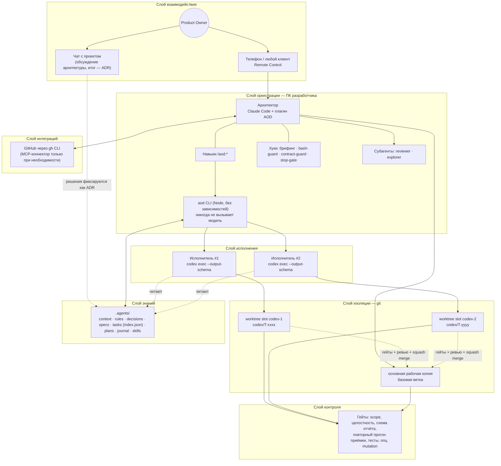
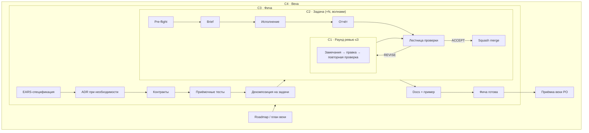
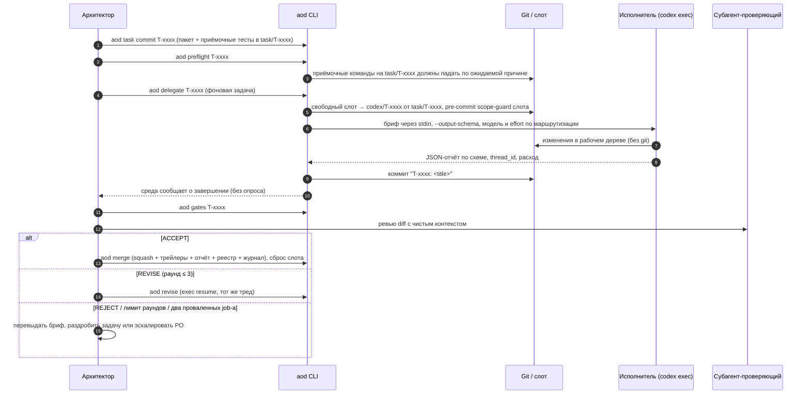
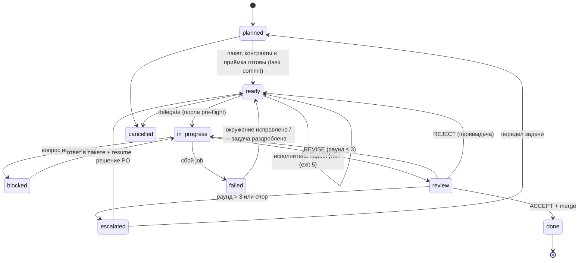

# AOD — Architect-Orchestrated Development

Методология разработки программного продукта командой из владельца продукта, модели-архитектора и
параллельных coding-агентов.

Версия 2.0 · 2026-10-17 · Обобщение практики, сложившейся на проекте «Небосвод»; от проекта не зависит.

> Русская редакция методологии AOD 2.0. Английская редакция — [methodology.md](methodology.md); номера
> разделов в обеих совпадают, поэтому ссылки вида «§18» или «§21.4» ведут в один и тот же раздел. Версия 1.0
> сохранена в истории git. Изменения относительно 1.0 взяты из [aod-2.0-research.md](aod-2.0-research.md) и
> решений в [.agents/decisions/](../.agents/decisions/index.md); их реализует Claude Code-плагин из этого
> репозитория. Изменённое или новое помечено **2.0**.

---

## Содержание

1. [Исходная проблема](#1-исходная-проблема)
2. [Принципы процесса](#2-принципы-процесса)
3. [Глоссарий](#3-глоссарий)
4. [Роли и права](#4-роли-и-права)
5. [Технологический стек](#5-технологический-стек)
6. [Рабочее пространство и репозиторий](#6-рабочее-пространство-и-репозиторий)
7. [Иерархия циклов](#7-иерархия-циклов)
8. [Цикл фичи](#8-цикл-фичи-c3)
9. [Цикл задачи](#9-цикл-задачи-c2)
10. [Раунд ревью](#10-раунд-ревью-c1)
11. [Машина состояний задачи](#11-машина-состояний-задачи)
12. [Сессия](#12-сессия)
13. [Параллелизм](#13-параллелизм)
14. [Взаимодействие с владельцем продукта и удалённое управление](#14-взаимодействие-с-владельцем-продукта-и-удалённое-управление)
15. [Интеграции через MCP](#15-интеграции-через-mcp)
16. [Форматы артефактов](#16-форматы-артефактов)
17. [Безопасность и красные линии](#17-безопасность-и-красные-линии)
18. [Метрики](#18-метрики)
19. [Границы применимости и режимы отказа](#19-границы-применимости-и-режимы-отказа)
20. [Запуск нового проекта (bootstrap)](#20-запуск-нового-проекта-bootstrap)
21. [Приложение: шаблоны](#21-приложение-шаблоны)

---

## 1. Исходная проблема

Когда разработку ведут LLM-агенты, узким местом оказывается не скорость генерации кода, а шесть дефицитов.

| # | Дефицит | Как проявляется | Механизм AOD, который его закрывает |
| --- | --- | --- | --- |
| D1 | Дорогое внимание сильной модели | Сильная модель тратит бюджет токенов на шаблонный код, который могла бы написать модель дешевле | Разделение ролей: сильная модель решает и проверяет, исполнители пишут код (§4); маршрутизация моделей по задачам (§5.4) |
| D2 | Контекст не переживает сессию | Каждая новая сессия начинается «с нуля»; решения, принятые в чате, растворяются | Память проекта в репозитории: `.agents/` (§6.3), JSON-реестр задач (§16.7) |
| D3 | Самопроверка ненадёжна | Модель, проверяющая свой же код, разделяет с ним слепые зоны; отчёт агента уверенный, но не обязательно верный | Сначала детерминированные гейты, затем проверяющий с чистым контекстом, желательно другого семейства моделей (§10) |
| D4 | Владелец продукта отсутствует физически | Решения ждут, пока человек вернётся к компьютеру | Remote Control, асинхронные запросы решений (§14) |
| D5 | Параллельные агенты мешают друг другу | Конфликты в одной рабочей копии, гонки за сборочные кэши, «чужие» правки | Изоляция через git worktree-слоты и scope задачи (§13) |
| D6 | **2.0** Использование моделей — общий скользящий бюджет | Чат, архитектор и исполнители расходуют одни и те же лимиты подписок; модели по умолчанию и высокое reasoning effort исчерпывают их быстрее всего | Сначала самый дешёвый механизм (P11), пресеты маршрутизации (§5.4), учёт расхода по задачам (§18) |

Исторический контекст. По сути AOD переносит на агентов классическую организацию инженерной команды:
технический лидер/архитектор, разработчики, code review, Architecture Decision Records (Nygard, 2011),
trunk-based development, Design by Contract, acceptance-test-first. Поправки делаются под свойства агента,
которые отличают его от человека-разработчика:

- не помнит ничего между сессиями, поэтому вся память внешняя и явная;
- не задаёт вопросов вовремя и уверенно заполняет пробелы догадками, поэтому спецификация должна быть
  исчерпывающей, а неясность — поводом остановиться (`blocked`), а не импровизировать;
- склонен «чинить» проверку вместо кода (ослабить допуск, пропустить тест, подставить ожидаемое значение),
  поэтому контракты и приёмочные тесты недоступны ему на запись. **2.0:** опубликованные бенчмарки фиксируют
  такое поведение и у Codex, и у Claude Code, а буквальное правило остановки в брифе резко его снижает;
  read-only тесты необходимы, но недостаточны (§10.4);
- **2.0:** качество его работы падает с ростом контекста, поэтому сессии короткие, объёмное чтение
  делегируется, а diff проверяется по областям;
- дёшев и параллелится, поэтому выгодно резать работу на много мелких независимых задач.

---

## 2. Принципы процесса

Это инварианты: если конкретная настройка проекта противоречит принципу, неправа настройка.

| ID | Принцип | Формулировка |
| --- | --- | --- |
| P1 | Разделение решения и исполнения | Тот, кто принимает архитектурное решение, не пишет основной объём кода; тот, кто пишет код, не меняет решения |
| P2 | Contracts first | Схемы, интерфейсы и приёмочные тесты появляются раньше реализации и фиксируются архитектором |
| P3 | Repo as memory | Всё значимое записано в репозитории (`.agents/`). Чего нет в репозитории, того не существует для следующей сессии |
| P4 | Verify, don't trust | Отчёт исполнителя — это гипотеза. Факт — это прогон приёмочных команд и чтение diff проверяющим |
| P5 | Независимая проверка (**2.0**, новая формулировка) | Сначала детерминированные гейты, затем проверяющий с чистым контекстом, желательно другого семейства моделей. Порядок ценности: гейты > чистый контекст > разнообразие семейств. Код, который архитектор пишет сам, тоже проверяет другое семейство |
| P6 | Изоляция исполнения | Одна задача = один исполнитель = одна ветка = один слот. Основная рабочая копия исполнителю недоступна |
| P7 | Ограниченные циклы | Каждый цикл имеет критерий выхода и лимит итераций; превышение лимита ведёт к эскалации, а не к бесконечной правке |
| P8 | Асинхронный владелец | Владельцу продукта не нужно быть у компьютера. Всё, что требует его участия, формулируется как решение с вариантами и рекомендацией |
| P9 | Reference, don't paste | Агентам передаются пути к файлам, а не их содержимое; брифы короткие |
| P10 | Трассируемость | Любое изменение в базовой ветке прослеживается до задачи → спецификации/ADR → записи в журнале |
| P11 | **2.0** Сначала самый дешёвый механизм | Детерминированные проверки идут первыми и всегда; объём делают малые модели; сильнейшая модель видит только решения и споры. Самый дешёвый токен — неотправленный |
| P12 | **2.0** Принуждать, а не инструктировать | Каждая красная линия, которую можно проверить механически, — это хук или гейт, а не фраза в `AGENTS.md`. В инструкциях остаётся только то, что требует суждения |

---

## 3. Глоссарий

| Термин | Определение |
| --- | --- |
| Product Owner (PO), владелец продукта | Человек. Владеет видением, требованиями и красными линиями, принимает решения, которые нельзя вывести из имеющегося контекста |
| Architect-Orchestrator, архитектор | Сильная модель. Принимает архитектурные решения, пишет контракты и приёмочные тесты, режет работу на задачи, делегирует, проверяет, мержит |
| Implementer, исполнитель | Coding-агент на модели другого семейства. Реализует ровно одну задачу внутри её scope |
| Reviewer, проверяющий | Функция независимой проверки результата. **2.0:** по умолчанию — субагент с чистым контекстом и review checklist; вердикт выносит архитектор |
| Gate, автоматический контролёр | Не-LLM проверка: тесты, линтеры, type checker, scope-guard, проверки целостности тестов, валидация отчёта, опционально mutation testing |
| Hook, хук | **2.0** Детерминированный скрипт, который среда агента запускает по событию (начало сессии, перед вызовом инструмента, конец хода). Его нельзя уговорить |
| Skill, навык | **2.0** Процедура (`SKILL.md`), загружаемая по требованию. Заменяет playbooks версии 1.0 как исполняемая форма процедуры |
| Delegation runner, запуск делегирования | **2.0** Заменяет мост из 1.0. `aod delegate` запускает исполнителя неинтерактивно (`codex exec` со схемой вывода) в слоте как фоновую задачу; среда сообщает архитектору о её завершении |
| Workspace, рабочее пространство | Необязательная корневая папка (не git), объединяющая репозитории проекта, слоты и конфигурацию агентов. **2.0:** достаточно одного репозитория и соседней папки для слотов |
| Slot, слот | Постоянный git worktree для исполнителя. Слоты переиспользуются, а не создаются под каждую задачу |
| Contract, контракт | Машинно-проверяемое описание интерфейса: схема данных, API, сигнатура. Единственный источник истины |
| Acceptance tests, приёмочные тесты | Тесты, написанные архитектором до реализации и падающие «по правильной причине». Исполнитель не может их менять |
| Spec, спецификация | Описание фичи или экрана до реализации. **2.0:** требования записываются в синтаксисе EARS, каждое привязано к приёмочному тесту. Крупные спецификации утверждает PO |
| EARS | **2.0** Easy Approach to Requirements Syntax: «When \<триггер>, the system shall \<реакция>» и родственные шаблоны; одно предложение соответствует одному приёмочному тесту |
| ADR | Architecture Decision Record: запись одного значимого решения (контекст, решение, последствия, статус). Принятый ADR обязателен к исполнению |
| Task packet, пакет задачи | Файл `T-xxxx.md` с YAML front matter (scope, контракты, ограничения, приёмочные команды, бюджет) и кратким телом. Единица делегируемой работы |
| Brief, бриф | Сообщение, которым архитектор запускает исполнителя. Ссылается на пакет задачи и не дублирует его |
| Scope | Список globs, которые исполнителю разрешено менять. Всё остальное для него read-only |
| Report, отчёт | JSON-документ исполнителя по фиксированной схеме: статус, коммиты, файлы, прогоны проверок, отклонения, вопросы, риски. **2.0:** схему обеспечивает среда исполнителя через output schema |
| Ledger, реестр задач | **2.0** `.agents/tasks/index.json`: единственный источник истины по статусу задач, раундам, слоту, треду, модели, расходу и истории событий; проверяется по схеме. `index.md` генерируется из него |
| Routing preset, пресет маршрутизации | **2.0** Именованное соответствие ролей (implement, escalate, explore) модели и reasoning effort |
| Wave, волна | **2.0** Набор готовых задач с выполненными зависимостями и непересекающимися scope, которые идут параллельно, по одной на слот |
| Unlock, разблокировка | **2.0** Ограниченное по времени и журналируемое разрешение архитектору править защищённые пути (контракты, приёмочные тесты) |
| Verdict, вердикт | Результат проверки: `ACCEPT`, `REVISE` или `REJECT` |
| Finding, замечание | Пункт ревью с уровнем серьёзности, местом в коде, требуемым изменением и командой проверки |
| Round, раунд | Одна итерация «замечания → исправление → повторная проверка». Лимит — 3 раунда |
| Escalation, эскалация | Передача решения PO в формате «задача, разногласие, варианты, рекомендация» |
| Session, сессия | Ограниченный по времени отрезок работы архитектора с протоколом начала и завершения |
| Journal, журнал | Одна запись на сессию: что сделано, что нет, принятые решения, открытые вопросы, следующий шаг |
| Playbook | Пошаговая процедура для повторяющейся операции. **2.0:** поставляется как skill |
| Definition of Done (DoD) | Общий для проекта список условий, без выполнения которых задача не считается завершённой |
| Milestone, веха | Поставка с измеримыми критериями выхода, которые принимает PO |

---

## 4. Роли и права

### 4.1. Product Owner

Делает: формирует видение и требования, задаёт красные линии; утверждает крупные спецификации и вехи;
разрешает эскалации; решает вопросы вкуса, приоритетов, лицензирования и денег. Не делает: не пишет код и
не микроменеджит задачи. Его время — самый дефицитный ресурс системы, поэтому каждое обращение к нему —
это готовое к решению меню вариантов.

### 4.2. Architect-Orchestrator

Делает: держит целостность архитектуры; пишет ADR, контракты, спецификации, приёмочные тесты; режет работу
на задачи и строит граф зависимостей; готовит слоты и брифы; мониторит исполнителей; проверяет каждый
результат сам; единственный, кто мержит в базовую ветку; ведёт журнал, план и реестр задач; работает с
внешними сервисами (issues, PR, релизы). Может сам реализовывать то, что не делегируется (см. §9.1): UI/UX,
ядро безопасности, мелкие правки. **2.0:** код, который архитектор пишет сам, до коммита проверяет другое
семейство моделей (`/aod:cross-review`); в 1.0 такой код оставался без ревью.

### 4.3. Implementer

Делает: реализует одну задачу внутри scope; пишет unit-тесты к своему коду; прогоняет приёмку; формирует
отчёт. Не делает: не задаёт вопросов посреди работы (при неясности останавливается со статусом `blocked` и
одним точным вопросом); не меняет контракты, приёмочные тесты, ADR, `.agents/`; не пушит, не переписывает
историю, не переключает ветки; не использует вложенных агентов, MCP-инструменты, веб и визуализации, если
пакет явно не разрешает.

**2.0:** исполнитель работает в sandbox, где `.git` доступен только на чтение, и не делает коммитов вовсе.
Он оставляет изменения в рабочем дереве; AOD коммитит их после прогона (`T-xxxx: <title>`, автор
«Codex (AOD implementer)»), а scope-гейт проверяет каждый файл. Отчёт пишется через output schema, исполнитель
его не коммитит.

### 4.4. Reviewer

Функция, а не обязательно отдельный агент. Главное требование — независимость от исполнителя: чистый контекст
и собственный прогон проверок. **2.0:** проверяющий по умолчанию — read-only субагент, который начинает с
чистого контекста и читает diff против пакета, спецификации и review checklist; вердикт выносит архитектор.
Разнообразие семейств — вторичный фактор: результат Codex проверяет субагент Claude, результат Claude —
Codex (`codex exec review`). Когда бюджет одного семейства исчерпан, проверяющий того же семейства с чистым
контекстом — допустимая замена.

### 4.5. Gates

Не-LLM контролёры, которые нельзя уговорить: тесты, форматтеры, линтеры, type checker, scope-guard
(проверка, что коммиты ветки задачи трогают только пути из `scope`), валидация отчёта по JSON Schema,
аудит лицензий зависимостей. **2.0** добавляет проверки целостности (удалённые или переименованные тесты,
новые маркеры skip/only/xfail, продуктовый код, распознающий запуск тестов; изменённые тесты, изменённые
допуски и сравнения с литералами из приёмочных тестов помечаются для проверяющего) и опциональное
mutation testing по изменённым файлам (§10.4).

### 4.6. Хуки (**2.0**)

Хуки обеспечивают красные линии внутри самой среды агента, до того как модель успеет действовать: брифинг в
начале сессии, Bash-guard против разрушительных git-операций и записи в защищённые пути из оболочки,
contract-guard на правку файлов и включаемая по желанию проверка «done means green» в конце хода. Вне
инициализированного AOD-репозитория они молчат, а при внутренней ошибке не блокируют работу (§17.2).

### 4.7. Матрица прав

D — принимает решение, W — пишет, R — читает, — нет доступа.

| Артефакт | PO | Архитектор | Исполнитель | Гейты и хуки |
| --- | --- | --- | --- | --- |
| Видение, требования, красные линии | D | W | R | — |
| ADR | D (крупные) | D/W | R | contract-guard защищает принятые ADR |
| Спецификации | D (крупные) | W | R | EARS-линт |
| Контракты (схемы, API) | — | D/W (через unlock) | R | проверяют; contract-guard защищает |
| Приёмочные тесты | — | D/W (через unlock) | R | исполняют; contract-guard защищает |
| Пакеты задач, план, реестр | — | W | R | валидируют front matter и схему реестра |
| Код в scope задачи | — | R (ревью) | W (без коммита; коммитит AOD) | проверяют scope и целостность |
| Отчёт задачи | R | R | W (через output schema) | валидируют схему |
| Журнал | R | W | — | `aod journal check` |
| Базовая ветка (`main`) | — | W (squash merge) | — | защищают |
| Конфигурация агентов (`AGENTS.md`, `CLAUDE.md`, `aod.config.json`, хуки) | — | W | R | — |

---

## 5. Технологический стек

### 5.1. Слои



### 5.2. Компоненты и их назначение

| Слой | Компонент (базовый выбор) | Назначение | Замена допустима? |
| --- | --- | --- | --- |
| Взаимодействие | Remote Control для Claude Code | PO управляет локальной сессией архитектора с телефона или другого устройства | Да: любой канал к той же сессии |
| Взаимодействие | Чат с подключённым проектом | Длинные архитектурные обсуждения; итог записывается в репозиторий как ADR. **2.0:** расходует тот же лимит, что и разработка, поэтому заканчивается ADR, а не продолжением чата | Да |
| Оркестрация | Claude Code с плагином AOD, запущенный в репозитории | Архитектор: собирает, тестирует, работает с git, делегирует | Ядро метода |
| Оркестрация | **2.0** Навыки (`/aod:*`) | Исполняемые процедуры, загружаются только при использовании | Процедуры — ядро; формат зависит от среды |
| Оркестрация | **2.0** Хуки | Детерминированное соблюдение красных линий (§17.2) | Ядро метода |
| Оркестрация | **2.0** `aod` CLI (`scripts/aod.mjs`, Node.js >= 20, без npm-зависимостей) | Вся механика: слоты, делегирование, гейты, merge, реестр, журнал, ADR, спецификации, ретро. Навыки вызывают CLI; CLI никогда не вызывает модель | Да, если операции сохраняются |
| Оркестрация | `AGENTS.md` (общий), `CLAUDE.md` (специфичный для архитектора, тонкий импорт `@AGENTS.md`) | Инструкции, которые агенты загружают автоматически от `cwd` вверх | Имена файлов зависят от агентов |
| Исполнение | **2.0** Codex CLI через `codex exec` (неинтерактивно, `--output-schema`, `--json`, `exec resume`) | Реализация задач; доработки продолжают тот же тред | Да: любой агент с неинтерактивным режимом, схемой вывода и продолжением сессии |
| Исполнение | **2.0** Субагенты (reviewer, explorer) | Ревью с чистым контекстом; объёмное чтение, которое иначе заполнило бы контекст архитектора | Да |
| Изоляция | git worktree, ветки `task/*`, `codex/*`, `claude/*`, `slot/*` | Параллельная работа без конфликтов, общий object store | Ядро метода |
| Изоляция | Общие кэши (ccache, uv, pnpm…) | Дешёвые слоты: сборка не повторяется с нуля | По стеку |
| Знания | `.agents/` в продуктовом репозитории | Память проекта для агентов и людей | Ядро метода |
| Интеграции | **2.0** `gh` CLI из навыка; MCP-коннекторы — только когда их требует задача | Issues, PR, комментарии, merge, теги и релизы | Да: GitLab и т. п. |
| Контроль | Гейты (`aod gates`), CI, pre-commit-форматтеры | Гейты из §4.5 | Ядро метода |

### 5.3. Почему исполнитель — модель другого семейства

Отчасти дело в цене: семейство исполнителя расходует отдельный лимит. **2.0** поправляет утверждение 1.0, что
перекрёстное ревью между семействами — главный источник независимости. Исследования LLM-судей показывают:
основная измеренная польза идёт от детерминированного верификатора и проверяющего с чистым контекстом, а у
моделей разных семейств есть общие предубеждения о стиле и структуре. Поэтому разнообразие семейств
остаётся как вторичный фактор там, где оно дёшево: Codex реализует — проверяет субагент Claude; Claude
реализует — проверяет Codex. Всё это работает только при соблюдении P4: проверяющий сам прогоняет приёмку и
читает diff, а не пересказ.

### 5.4. Маршрутизация моделей (**2.0**)

Маршрутизация — самый сильный рычаг стоимости. Каждый вид работы уходит самой дешёвой модели, которая с ним
хорошо справляется.

| Работа | Агент и класс модели | Effort |
| --- | --- | --- |
| ADR, спецификации, контракты, приёмочные тесты | Архитектор, сильнейшая модель (plan mode) | high |
| Брифы, обновления реестра и журнала, merge | Архитектор, модель среднего уровня; структуру несут навыки | medium |
| Объёмное чтение, вопросы «где X» | Explorer: малая модель, только чтение (`/aod:explore`) | low |
| Реализация по хорошей спецификации | Исполнитель, роль `implement` | medium |
| Трудная задача, задача после сбоя, раунд ревью 2+ | Исполнитель, роль `escalate` | high |
| Реализация UI/UX | Архитектор (вкус остаётся за архитектором); проверяет Codex | medium |
| Ревью результата исполнителя | Гейты, затем субагент с чистым контекстом и чек-листом | medium |
| Ревью кода архитектора | Ревью Codex (`aod review`) | medium |
| Форматирование, переименования, кодогенерация | Скрипты и хуки, без модели | — |

Роли исполнителя настраиваются в `aod.config.json` в разделе `routing` (`implement`, `escalate`, `explore`,
у каждой `{model, effort}`) и переключаются командой `aod route preset economy|balanced|max`. Имена моделей —
это данные, а не методология: они меняются быстрее метода, и модель, которой нет в локальном кэше Codex, даёт
предупреждение, а не ошибку. Эскалация — по факту: `escalate` используется, когда у задачи уже был проваленный
job, и начиная со второго раунда ревью; собственные `model`/`effort` пакета или флаг CLI перекрывают
маршрутизацию. Высокий reasoning effort — исключение, а не норма. Модель субагентов архитектора задаётся явно,
чтобы исследование кода не шло молча на сильнейшей модели.

---

## 6. Рабочее пространство и репозиторий

### 6.1. Workspace

**2.0:** базовая раскладка — один репозиторий и соседняя папка для слотов
(`worktrees_dir: "../<repo>-worktrees"` в `aod.config.json`). Многорепозиторное рабочее пространство ниже
остаётся вариантом, когда рядом с продуктом нужен публичный репозиторий или legacy-эталон.

```text
<project>-workspace/                 # НЕ git-репозиторий; корень сессии архитектора
├── AGENTS.md                        # карта репозиториев и правила для всех агентов
├── CLAUDE.md                        # роль архитектора; импортирует AGENTS.md
├── .claude/                         # локальные настройки архитектора
├── <product>/                       # основной приватный репозиторий (main checkout)
├── <product>-sdk/                   # опционально: публичный репозиторий (строгая граница утечки)
├── <product>-legacy/                # опционально: прежняя реализация, READ-ONLY
└── <product>-worktrees/             # слоты исполнителей
    ├── codex-1/                     # git worktree <product>, ветка slot/codex-1 или codex/T-xxxx
    └── codex-2/
```

Правила workspace: в корне нет рабочих файлов, кроме конфигурации агентов, которую ведёт только архитектор;
одна задача работает внутри ровно одного репозитория и подчиняется его `AGENTS.md`; legacy только для
чтения; в публичный репозиторий не попадает внутренняя архитектура, содержимое `.agents/` и проприетарный
код.

### 6.2. Продуктовый репозиторий

```text
<product>/
├── AGENTS.md            # описание продукта, «что читать перед работой», инварианты, карта владения, DoD, «никогда»
├── CLAUDE.md            # специфика архитектора; @AGENTS.md
├── aod.config.json      # 2.0: базовая ветка, слоты, маршрутизация, защищённые globs, гейты, таймауты
├── .agents/             # память проекта (§6.3)
├── schemas/             # контракты — единственный источник истины; владелец — архитектор
├── tests/acceptance/    # приёмочные тесты; владелец — архитектор
├── <code areas>/        # у каждой области в карте указан владелец: исполнитель или архитектор
└── docs/                # пользовательская документация (docs-as-code)
```

Карта владения в `AGENTS.md` — таблица «путь → назначение → владелец». Unit-тесты лежат рядом с кодом и
принадлежат владельцу кода. `/aod:init` создаёт `AGENTS.md`, `CLAUDE.md`, `aod.config.json` и `.agents/`.

### 6.3. Папка `.agents/`

| Папка | Содержание | Меняется, когда | Читатель |
| --- | --- | --- | --- |
| `context/` | Стабильное знание: vision, glossary, invariants, architecture, domain model, formats, tech stack, validation | Архитектура эволюционирует (через ADR) | все |
| `rules/` | Правила по языкам и областям: code style, testing, git, security, docs, review checklist | Правило добавлено или уточнено | все |
| `decisions/` | ADR-xxxx + `index.md` со статусами + `template.md` | Принято значимое решение | все |
| `specs/` | Спецификации фич (`S-xxxx`) и экранов (`W-xxxx`) до реализации; **2.0:** требования в EARS | Фича запланирована | архитектор, PO |
| `tasks/` | Пакеты `T-xxxx.md`, отчёты `T-xxxx.report.json`, `template.md`; **2.0:** `index.json` (реестр, источник истины), генерируемый `index.md`, `jobs/` (артефакты прогонов, в git-ignore) | Работа делегирована или отслеживается | все |
| `plans/` | `roadmap.md`, план вехи `M<n>.md`, `backlog.md` | Изменилось планирование | архитектор, PO |
| `skills/` | **2.0** Навыки для исполнителя, например `aod-implementer/SKILL.md`, который Codex загружает в каждом слоте | Изменились правила исполнителя | исполнитель |
| `journal/` | `YYYY-MM-DD-<slug>.md` — по записи на сессию | Каждая сессия | все, особенно следующая сессия |

В каждой папке лежит `README.md`: что здесь хранится, как называются файлы, шаблон. **2.0:** папку `playbooks/`
из 1.0 заменили навыки; навыки архитектора поставляются с плагином, поэтому в проекте остаются только
процедуры, специфичные для него.

Приоритет при противоречии документов: принятый ADR > `context/invariants.md` > прочий `context/` >
`rules/` > specs > tasks. Агент, обнаруживший противоречие, сообщает о нём, а не выбирает молча.

Почему это работает: `.agents/` — внешняя долговременная память с адресуемой структурой. Агенту не нужно
держать всё в контексте; `AGENTS.md` содержит таблицу «тип задачи → что читать первым», поэтому каждый агент
загружает минимально достаточное подмножество (P9). Для людей та же папка служит документацией решений и
историей проекта.

### 6.4. Ветки

| Ветка | Кто создаёт | Содержимое |
| --- | --- | --- |
| `main` (базовая ветка, настраивается) | — | Trunk. Пишет только архитектор через squash merge |
| `task/T-xxxx` | Архитектор (`aod task commit`, без переключения основной копии) | Пакет задачи + приёмочные тесты (+ контракты, спецификации и ADR, от которых она зависит, закоммиченные заранее) |
| `codex/T-xxxx` | Создаётся в слоте от `task/T-xxxx`; **2.0:** изменения исполнителя коммитит AOD | Реализация |
| `claude/<topic>` | Архитектор | Собственная работа архитектора |
| `slot/codex-N` | Архитектор | Базовая ветка слота в покое |

Изменения исполнителя — это ровно `task/T-xxxx..codex/T-xxxx`; именно этот диапазон проверяет scope-гейт.
**2.0:** `aod task commit` отказывается работать, пока спецификация или контракты пакета не закоммичены в
базовой ветке; `aod task sync T-xxxx` подтягивает базовую ветку в ветку задачи без checkout и после
делегирования отказывается без `--force`.

Коммиты: Conventional Commits; коммиты задачи начинаются с `T-xxxx: `. В squash merge — трейлеры
`Implemented-by:` и `Reviewed-by:`. Ссылки на AI-сессии, чаты и внутренние URL в коммиты, PR и теги не
попадают.

---

## 7. Иерархия циклов

Определения:

- Цикл — замкнутый процесс с входом, выходом и критерием завершения (exit criterion), владелец которого
  назначен заранее.
- Итерация — один проход внутри цикла. У каждого цикла есть лимит итераций или бюджет времени.
- Циклы вложены: выход внутреннего цикла — шаг внешнего.

| Уровень | Цикл | Триггер | Вход | Выход | Критерий выхода принимает | Масштаб |
| --- | --- | --- | --- | --- | --- | --- |
| C4 | Цикл вехи (Milestone cycle) | Начало вехи по roadmap | Цели вехи, критерии выхода | Поставка, принятая PO | PO | недели |
| C3 | Цикл фичи (Feature cycle) | Issue, требование, потребность | Требование | Спецификация, ADR, контракты, приёмочные тесты, граф задач, а в конце — фича в базовой ветке с документацией | архитектор (PO для крупных спецификаций) | дни |
| C2 | Цикл задачи (Task cycle) | Задача в статусе `ready` | Пакет, слот | Один squash-коммит в базовую ветку (код, отчёт, реестр, журнал) | архитектор | минуты–часы |
| C1 | Раунд ревью (Review round) | Вердикт `REVISE` | Список замечаний | Исправления + повторная проверка | архитектор; лимит 3 | минуты |
| S | Сессия (ортогонально) | PO или расписание запускает работу | Журнал, план, реестр | Чистое дерево, запись в журнале, обновлённый реестр | архитектор | часы |



Ключевое свойство иерархии: стоимость ошибки растёт снизу вверх, а частота вмешательства PO падает сверху
вниз. PO участвует в C4 всегда, в C3 — для крупных спецификаций и эскалаций, в C2/C1 — только через
эскалацию.

---

## 8. Цикл фичи (C3)

| Шаг | Что происходит | Артефакт | Владелец |
| --- | --- | --- | --- |
| 1. Потребность | Issue, требование PO или вывод архитектора | issue / запись в backlog | PO, архитектор |
| 2. Спецификация | Поведение, сценарии, границы, критерии приёмки. **2.0:** каждое требование в форме EARS со строкой `Acceptance:`, называющей его тест; `aod spec check` проверяет это (`/aod:spec`) | `.agents/specs/S-xxxx-*.md` | архитектор; крупные утверждает PO |
| 3. ADR | Нужен, если меняется контракт, зависимость, формат, научная/предметная модель или процесс (`/aod:adr`) | `.agents/decisions/ADR-xxxx-*.md` | архитектор; спорные решает PO |
| 4. Контракты | Схемы и интерфейсы, из которых генерируются типы для всех слоёв | `schemas/**` | архитектор |
| 5. Приёмочные тесты | Пишутся до реализации и падают по ожидаемой причине (не из-за синтаксиса или импорта) | `tests/acceptance/**` | архитектор |
| 6. Декомпозиция | Разбиение на задачи с явным графом `depends_on`; каждая задача проверяема своей приёмкой (`/aod:packet`) | `.agents/tasks/T-xxxx.md`, реестр | архитектор |
| 7. Реализация | Цикл C2 для каждой задачи, независимые — параллельными волнами (§13) | ветки, слоты | исполнители / архитектор |
| 8. Документация и пример | Пользовательская документация и пример в том же изменении | `docs/`, `examples/` | архитектор или задача |
| 9. Закрытие | Обновление плана вехи, журнал, закрытие issue | `plans/`, `journal/` | архитектор |

Правило декомпозиции: задача хорошая, если её приёмку можно выразить списком команд, scope — списком globs,
а решение не требует вкуса или выбора между равноценными архитектурными вариантами. Иначе её нужно дробить
дальше или оставить архитектору. **2.0:** scope к тому же должен быть узким и честным: планировщик волн
сравнивает префиксы globs, и широкий scope (`src/**`) блокирует параллелизм.

---

## 9. Цикл задачи (C2)

### 9.1. Решение «делегировать или нет»

| Делегировать | Не делегировать (архитектор делает сам или эскалирует) |
| --- | --- |
| Реализация по готовой спецификации с приёмочными тестами | Архитектурные и контрактные решения |
| Портирование старого кода с дифференциальными тестами | Изменения схем и приёмочных тестов |
| Bindings, сериализаторы, адаптеры, генераторы | UI/UX и всё, что оценивается вкусом (**2.0:** с ревью Codex до коммита) |
| Unit-тесты к коду исполнителя | Неоднозначные задачи |
| Починка CI в путях исполнителя | Ядро безопасности и лицензирования (**2.0:** с ревью Codex до коммита) |
| Read-only исследование большого объёма кода (**2.0:** `/aod:explore`) | Всё, что требует решения PO |
| | Работа, которую архитектор закончит быстрее, чем подготовит бриф (порог около 10 минут) |

### 9.2. Фазы



| Фаза | Кто | Содержание | Критерий выхода |
| --- | --- | --- | --- |
| 0. Pre-flight | архитектор + `aod preflight` | **2.0** автоматизирован (§21.4): пакет валиден и закоммичен в `task/T-xxxx`; зависимости выполнены; контракты есть в ветке задачи, ADR в статусе Accepted; спецификация проходит линт, пакет называет ID требований; новые приёмочные тесты на месте; scope не пересекается с активными задачами; размер брифа в пределах лимита; приёмочные команды на ветке задачи падают по ожидаемой причине. Смысловая согласованность документов остаётся суждением модели в навыке | Все проверки пройдены |
| 1. Brief | `aod delegate` | Короткий структурированный бриф (§16.2) из шаблона и пакета, со ссылками на файлы и правилом остановки | Передан исполнителю через stdin |
| 2. Execution | исполнитель | Прочитать `read_first`, изучить код, реализовать маленькими шагами с прогоном тестов, прогнать всю приёмку, оставить изменения незакоммиченными | Приёмка зелёная, или `blocked` с одним вопросом |
| 3. Monitoring | среда | **2.0** Ручного опроса нет. Прогон — фоновая задача, и среда сообщает архитектору о её завершении; тем временем архитектор готовит следующие пакеты. Запуск останавливает job после `budget_minutes × budget_factor` (1.5) или после 20 минут без активности (`timeouts` в `aod.config.json`) | Job завершён или остановлен по таймауту |
| 4. Report | среда исполнителя | **2.0** Обеспечивается `--output-schema`; AOD повторно валидирует отчёт как гейт и проверяет ограничения длины | Валидный JSON |
| 5. Verification | гейты + проверяющий | Лестница проверки (§10.4): гейты и целостность, затем ревью diff с чистым контекстом по областям — против чек-листа и замысла спецификации | Вердикт |
| 6. Verdict | архитектор | `ACCEPT` / `REVISE` / `REJECT` | — |
| 7. Merge | `aod merge` (`/aod:close`) | Один squash-коммит в базовую ветку: код, отчёт, реестр, журнал; сообщение `T-xxxx: <title>`; трейлеры `Implemented-by:` (с моделью) и `Reviewed-by:`; опционально минуты внимания | Базовая ветка зелёная |
| 8. Close | `aod merge` | Реестр обновлён (статус, раунды, вердикты, расход, события), слот сброшен на `slot/codex-N` | Слот свободен и чист |

### 9.3. Обработка сбоев

| Ситуация | Действие |
| --- | --- |
| `blocked` | Ответ записывается в пакет (коммит в `task/T-xxxx`, merge в ветку слота), затем тот же тред продолжается. Ответ на вопрос не считается раундом |
| Сбой, exit ≠ 0 | Прочитать конец stderr, починить окружение, новый job. Реестр считает проваленные job-ы |
| Два проваленных job-а подряд | Отклонить и раздробить задачу (CLI это рекомендует); следующая попытка идёт на модели `escalate` |
| **2.0** Исполнитель недоступен или исчерпал лимит (exit 5) | Задача возвращается в `ready` без учёта сбоя; архитектор останавливается и спрашивает PO (`/aod:decision`). Молчаливого перехода на другое семейство моделей нет |
| Правки вне scope | `REVISE` с blocker; повторно — `REJECT` и новый бриф |
| Job осиротел (запуск прерван) | Считать проваленным; осмотреть слот; новый job продолжает с текущего состояния дерева |
| Исполнитель ослабил тест или допуск | Всегда blocker, независимо от результата прогонов |

---

## 10. Раунд ревью (C1)

### 10.1. Вердикты

| Вердикт | Когда | Следствие |
| --- | --- | --- |
| `ACCEPT` | Все проверки пройдены, замечаний уровня blocker/major нет | Merge. Minor-замечания допустимо оставить как задачу в backlog |
| `REVISE` | Есть исправимые замечания | Revision brief продолжает тот же тред исполнителя: контекст сохраняется. Со второго раунда используется модель `escalate` |
| `REJECT` | Неверный подход, систематические выходы из scope, бриф был ошибочным | Сброс ветки; новый бриф или передел задачи |

### 10.2. Серьёзность замечаний

| Уровень | Охватывает |
| --- | --- |
| blocker | Нарушение контракта, некорректность, выход за scope, ослабление тестов, подгонка под тестовые входы |
| major | Недостаточные тесты (в том числе низкий mutation score), недетерминизм, производительность сверх бюджета |
| minor | Ясность, именование, комментарии |

Каждое замечание содержит место (`path:line`), проблему, требуемое изменение и команду проверки. Формат
поддаётся автоматической генерации и разбору.

### 10.3. Лимит и эскалация

Не больше трёх раундов. После третьего архитектор эскалирует PO: задача, суть разногласия, варианты,
рекомендация. Лимит защищает от двух патологий: бесконечного цикла «исправил одно — сломал другое» и
постепенного дрейфа требований через замечания ревью.

### 10.4. Лестница проверки (**2.0**)

Проверка — это лестница. Каждая ступень запускается, только если пройдена предыдущая, поэтому дешёвые ступени
отсеивают большинство проблем до того, как diff прочитает модель. Провал на любой ступени возвращает задачу в
тот же тред исполнителя; до сильнейшей модели или PO доходит только провал после третьего раунда.

| Ступень | Стоимость | Что выполняется |
| --- | --- | --- |
| 1. Гейты | скрипты, ноль токенов | Схема отчёта, scope-guard, формат, линт, типы, повторный прогон приёмки, unit-тесты затронутых пакетов |
| 2. Целостность тестов | скрипты плюс короткий проход модели | **fail**: удалённые или переименованные тесты, добавленные маркеры skip/only/xfail, продуктовый код, распознающий запуск тестов. **warn**: изменённые существующие тесты, изменённые допуски, сравнения в продуктовом коде с литералами из приёмочных тестов. Опционально mutation testing по изменённым нетестовым файлам — последним и только когда всё остальное зелёное |
| 3. Ревью с чистым контекстом | субагент или Codex | Diff по областям против `rules/review-checklist.md` и замысла спецификации; целенаправленный поиск захардкоженных ожидаемых значений, перегруженного равенства и подгонки под входы |
| 4. Эскалация | сильнейшая модель или PO | Только для изменений контрактов, ядра безопасности или спора после третьего раунда |

Зачем нужна вторая ступень: reward hacking (захардкоженные тестовые случаи, правка тестов) — главный режим
отказа делегированного кодинга, и он растёт с длиной задачи. Read-only тесты и буквальное правило остановки в
брифе предотвращают большую часть; проверки целостности и проверяющий ловят остальное. Mutation testing
измеряет, чувствительны ли unit-тесты исполнителя, а не то, верны ли они.

---

## 11. Машина состояний задачи



**2.0:** статусы (`planned | ready | in_progress | review | blocked | done | failed | escalated | cancelled`)
хранятся только в реестре (`tasks/index.json`); во front matter пакета статуса нет. Реестр также ведёт историю
событий по задаче (`delegated`, `job-failed`, `blocked`, `answered`, `revise`, `escalated`, `gates-fail`,
`scope-violation`, `accepted`, `rejected`, `unavailable`), из которой считаются метрики §18.

---

## 12. Сессия

Сессия — единица работы архитектора во времени. Она нужна потому, что архитектор, как и исполнитель, ничего
не помнит между запусками. **2.0:** сессии намеренно короткие. Качество любой модели падает с ростом
контекста, поэтому сессия заканчивается записью в журнале, а не разрастается в длинный чат; объёмное чтение
уходит explorer-у, ревью — свежему субагенту.

Начало (`/aod:session-start`; хук `SessionStart` уже подставляет следующий шаг из журнала, открытые задачи,
слоты и идущие job-ы):

1. Прочитать `AGENTS.md` и `CLAUDE.md`.
2. Прочитать последнюю запись журнала и текущий план вехи.
3. Прочитать пакет или спецификацию в работе и ADR, на которые они ссылаются.
4. `git status`: начинать с чистого дерева на правильной ветке; проверить состояние слотов и job-ов.
5. **2.0** Прогнать базовые команды (`session.baseline`), прежде чем что-либо трогать; красный baseline
   останавливает новую работу сессии, пока причина не понятна.

Завершение (`/aod:session-end`):

1. Проверки пройдены, всё закоммичено, дерево чистое; нет идущих job-ов и активного unlock.
2. Запись в журнале: сделано, не сделано, решения (со ссылками на ADR), открытые вопросы, следующий шаг
   (`aod journal check` проверяет структуру).
3. Обновлены реестр и план вехи; `aod session end --commit` коммитит файлы памяти.

Поле «следующий шаг» — это передача эстафеты следующей сессии; без него каждая сессия тратит время на
реконструкцию состояния. **2.0:** после сжатия контекста хук `SessionStart` заново подставляет
`context/invariants.md`, чтобы длинные сессии не теряли красные линии.

---

## 13. Параллелизм

Модель: N постоянных слотов (обычно 2–3), один job на слот, одна задача на job. Слоты делят git object store
и сборочные кэши, поэтому создаются один раз и сбрасываются после merge, а не пересоздаются.

Условия параллельного запуска двух задач:

- нет ребра `depends_on` между ними (**2.0:** проверяются зависимости и из реестра, и из пакета);
- их scope не пересекаются;
- контракты, от которых обе зависят, уже в базовой ветке — это и делает contracts-first условием
  параллелизма;
- есть свободный слот.

**2.0** Волны. `aod wave plan` выбирает в порядке ID готовые задачи, удовлетворяющие этим условиям, не больше
одной на свободный слот; `aod wave run` (`/aod:wave`) делегирует их параллельно и ждёт все. Обновления реестра
от параллельных job-ов сериализуются блокировкой. Проверка и merge остаются последовательными и принадлежат
архитектору; поздние задачи волны мержатся в уже сдвинувшуюся базовую ветку, и `aod merge` сначала проверяет
конфликты.

Узкое место системы — архитектор: пропускная способность ограничена скоростью подготовки пакетов и
ревью, а не числом исполнителей. Рычаги: заранее готовить пакеты следующей волны, пока исполнители заняты;
стандартизировать брифы и чек-листы (навыки); выносить первичное ревью в субагента с чистым контекстом
(§4.4); отдавать read-only исследования explorer-у, а не читать большой объём кода самому.

Пока исполнители работают, архитектор не ждёт впустую: среда сообщает о завершении job-а, а тем временем
архитектор готовит следующие задачи, контракты или собственную работу. **2.0:** долгоживущий планировщик и
agent teams (полноценные экземпляры моделей, переписывающиеся друг с другом) не используются: слоты
освобождаются только после ревью и merge, а agent teams многократно увеличивают расход дорогого лимита.

---

## 14. Взаимодействие с владельцем продукта и удалённое управление

### 14.1. Каналы

| Канал | Для чего | Где оседает результат |
| --- | --- | --- |
| Remote Control | Оперативное управление локальной сессией архитектора с любого устройства: команды, ответы на вопросы, решения | Журнал, ADR, пакеты |
| Чат с проектом | Длинные архитектурные обсуждения без доступа к коду. **2.0:** делит лимит с разработкой, поэтому заканчивается ADR | ADR / `context/` до начала реализации |
| GitHub | Issues как вход требований, PR как точка видимости | Issues/PR + ссылки в задачах |

Правило: решение, принятое в любом канале, не считается принятым, пока не записано в репозиторий (P3).

### 14.2. Что требует PO

Утверждение крупных спецификаций и вех; выбор между равноценными архитектурными вариантами с разными
продуктовыми последствиями; эскалации после лимита раундов; красные линии, лицензии, публичность,
внешние обязательства; необратимые действия (удаление веток или данных, публичные релизы, если они не
делегированы явно). **2.0:** профиль стоимости (пресет маршрутизации) и что делать, когда лимит исполнителя
исчерпан.

### 14.3. Формат запроса решения

`/aod:decision` формирует запрос в этом формате и сразу записывает ответ (ADR, пакет или журнал):

```text
Решение нужно по: <задача/фича, одна строка>
Контекст: <2–3 предложения, что уже известно>
Варианты:
  A. <вариант> — плюсы / минусы / стоимость
  B. <вариант> — плюсы / минусы / стоимость
Рекомендация: <A|B> потому что <причина>
Что будет без ответа: <архитектор продолжает с рекомендацией | работа по ветке стоит>
```

Последняя строка делает асинхронность явной: PO видит, блокирует ли его молчание работу.

### 14.4. Язык

PO общается с архитектором на родном языке. Всё, что пишется в репозитории — код, комментарии, коммиты,
документы `.agents/`, брифы исполнителям, — пишется на английском: так документы одинаково понимают все
агенты, а проект остаётся открытым для будущих участников.

---

## 15. Интеграции через MCP

MCP (Model Context Protocol) — единый способ подключать архитектору внешние системы как инструменты. **2.0:**
каждый подключённый сервер добавляет описания своих инструментов в контекст на каждом ходе, поэтому
коннекторы используются экономно. Мост к исполнителям в 1.0 был MCP-сервером; в 2.0 делегирование идёт через
`aod` CLI и `codex exec`, а работа с GitHub — через `gh` CLI из навыка, без постоянной нагрузки на контекст.

| Интеграция | Операции архитектора | Ограничения |
| --- | --- | --- |
| GitHub (по умолчанию `gh` CLI; MCP-коннектор при работе с телефона) | Разбор issues, ревью PR, комментарии, merge, теги, релизы, статус CI | Merge только после собственной проверки; без force-push и переписывания истории |
| Почта (опционально) | Чтение входящих требований, черновики ответов | Отправка — по явному разрешению PO |
| Облачный диск или коннектор документов (опционально) | Чтение исходных документов, общие документы со стороны PO, выгрузка отчётов | Только указанные папки |
| Трекер, календарь, мессенджер | По потребности проекта | Принцип наименьших привилегий |

Правила подключения: каждая интеграция получает минимально необходимые права; необратимые внешние действия
(отправка письма, публичный релиз) выполняются только по явному правилу или подтверждению PO; данные из
внешних систем — это входные данные, а не инструкции.

---

## 16. Форматы артефактов

### 16.1. Пакет задачи (`T-xxxx.md`)

Front matter машиночитаем и проверяется (`aod packet validate`, pre-flight):

```yaml
---
id: T-xxxx
title: <короткое повелительное название>
owner: codex            # codex | claude
milestone: M0
depends_on: []
spec: <путь к spec или none>
contracts: []           # пути схем и ID ADR, обязательные к соблюдению
scope:                  # globs, которые исполнитель может менять
  - src/<area>/**
forbidden: []           # дополнительные read-only globs; schemas/**, tests/acceptance/**, .agents/** запрещены всегда
constraints:
  - No new dependencies without an ADR.
acceptance:             # команды из корня репозитория; все должны пройти
  - <command>
deliverables: [code, unit tests, "docs: <path>"]
budget_minutes: 30
model: <необязательное переопределение маршрутизации>
effort: <необязательное переопределение маршрутизации>
---
```

**2.0:** в пакете нет `status` (им владеет реестр); `model` и `effort` — необязательные переопределения §5.4;
шаблонные заглушки (`<...>`) в `scope` или `acceptance` не проходят валидацию.

Тело: Context (зачем задача, ссылки; `Implements:` — ID требований спецификации), Design notes (уже принятые
решения), Pitfalls (известные ловушки), Out of scope.

### 16.2. Brief

Структура из XML-секций, чтобы модель исполнителя не путала роли частей:

| Секция | Содержание |
| --- | --- |
| `<role>` | Кто исполнитель, что за продукт (1–2 предложения), кто чем владеет, приоритеты (например, correctness > contract fidelity > determinism > clarity > performance > brevity) |
| `<task>` | ID, название, путь к пакету (авторитетен) |
| `<read_first>` | Пути: AGENTS.md, инварианты, пакет, нужные правила, контракты, ADR, исходники |
| `<scope>` | Что можно менять и что нельзя никогда |
| `<constraints>` | Из пакета: зависимости, детерминизм, единицы, бюджеты, допуски |
| `<acceptance>` | Нумерованный список команд |
| `<rules>` | Автономность; при неясности `blocked` с одним вопросом; **2.0 правило остановки:** «If a test or contract looks wrong, stop with status `blocked` and explain. Do not change, skip, special-case or weaken tests or tolerances»; никаких git-команд, меняющих состояние (коммитит AOD); минимальный diff; без вложенных агентов, MCP, веба и визуализаций; английский; без ссылок на AI-сессии |
| `<process>` | Прочитать → спланировать молча → маленькие шаги с тестами → вся приёмка → ответ |
| `<output_format>` | Только JSON-объект по схеме вывода; `commits` — `[]` |

Правило остановки — самое ценное предложение брифа: в опубликованном бенчмарке одна такая фраза снизила
долю reward hacking у модели с 93% до 1%.

Для read-only исследования (`aod explore`) используется укороченный бриф: роль (только чтение), один точный
вопрос, пути, формат «не больше N строк, каждое утверждение со ссылкой `path:line`, вместо догадки —
`unknown`».

### 16.3. Отчёт (`T-xxxx.report.json`)

Обязательные поля: `task_id`, `status` (`done | partial | blocked | failed`), `summary` (≤ 600 символов),
`commits[] {sha, message}`, `files_changed[]`, `checks[] {cmd, exit_code, result}`,
`deviations[] {what, why}`, `open_questions[]`, `risks[]`. `additionalProperties: false`.

**2.0:** схема достаточно строгая, чтобы её обеспечивала среда исполнителя (`--output-schema`): все свойства
обязательны, `additionalProperties: false` на каждом уровне, без ключевых слов длины; ограничения длины
проверяет гейт. Отчёт пишется в папку job-а и попадает в squash-коммит через `aod merge`.

Отчёт по схеме нужен для автоматизации и для того, чтобы исполнитель явно задекларировал отклонения и риски,
а не спрятал их в прозе.

### 16.4. Revision brief

```xml
<review task="T-xxxx" round="1">
Verdict: REVISE. Fix every finding; change nothing else.
F1 [blocker] path:line - <problem>. Required: <change>. Verify: <command>.
F2 [major] ...
All rules of the original brief still apply, including the scope and the stop rule for tests.
When done, leave the changes uncommitted and answer only with the JSON report.
</review>
```

`aod revise` отправляет его в тот же тред исполнителя (`codex exec resume`) и коммитит результат как
`T-xxxx: address review round N`.

### 16.5. Запись журнала

```markdown
# YYYY-MM-DD — <topic>
Agent: <architect|implementer>   Task: T-xxxx or none
## Done
## Not done
## Decisions (link ADRs)
## Open questions
## Next step
```

**2.0:** одна запись на день, которую переиспользуют следующие сессии того же дня; `aod journal check`
требует все разделы и непустые Done и Next step.

### 16.6. ADR

Минимум: заголовок `ADR-xxxx: <решение>`, Status (Proposed / Accepted / Superseded by ADR-yyyy), Date,
Context, Decision, Consequences, Alternatives considered. `decisions/index.md` — таблица всех ADR со
статусами. Принятый ADR не редактируется по существу: его заменяет новый ADR. **2.0:** `aod adr
new|accept|supersede` ведёт нумерацию, индекс и смену статусов; accept отказывает при пустых Context,
Decision или Consequences.

Сам процесс тоже фиксируется ADR-ом («Agent team protocol»): роли, модели, правила делегирования, лимиты.
Переход проекта с 1.0 на 2.0 фиксируется новым ADR, который его заменяет.

### 16.7. Реестр задач (`tasks/index.json`) (**2.0**)

В 1.0 это была Markdown-таблица. Модели склонны переписывать Markdown, поэтому в 2.0 реестр — JSON,
проверяемый по схеме и изменяемый только через CLI; `index.md` генерируется из него для людей.

По каждой задаче: id, название, владелец, веха, статус, `depends_on`, слот, ID треда, модель и effort, раунды,
вердикты, сбои, волна, время создания/старта/завершения, расход токенов (input, cached input, output,
reasoning), минуты внимания, заметки и история событий (§11). Верхний уровень: `version`, `next_id`, `tasks`.
Это одновременно доска задач и источник метрик (§18).

Правило реестра: `index.json` и `index.md` могут оставаться незакоммиченными в базовой ветке; их коммитит
`aod merge` или `aod session end --commit` — что случится раньше, — и никогда в ветке задачи.

### 16.8. Спецификация (`S-xxxx`) (**2.0**)

Спецификация описывает поведение пронумерованными EARS-требованиями. Каждое требование следует одному из пяти
шаблонов EARS, содержит ровно одно «shall», избегает размытых слов и сопровождается строкой `Acceptance:`,
называющей доказывающий его тест. `aod spec check` проверяет это; строка `Implements:` в пакете называет
покрываемые ID требований, так что каждое предложение спецификации прослеживается до теста, а дрейф
спецификации становится виден.

---

## 17. Безопасность и красные линии

### 17.1. Модель угроз

Coding-агент исполнителя, как правило, работает с правами пользователя и без запросов подтверждения. **2.0:**
sandbox Codex по умолчанию (`workspace-write`) ограничивает запись слотом и держит `.git` только на чтение; AOD
не отключает sandbox. Основные риски: правка вне назначенной области, разрушительные git-операции, утечка
внутреннего в публичное, обход проверок вместо исправления кода, неконтролируемые процессы и установки.

### 17.2. Меры

| Риск | Мера |
| --- | --- |
| Правка вне области | Работа только в слотах; scope в пакете; **2.0** pre-commit scope-guard в слоте плюс scope-гейт; contract-guard блокирует правку любого файла в слоте из сессии архитектора; проверка основной рабочей копии после каждой задачи |
| Разрушительные git-операции | **2.0** Хук bash-guard: блокирует force-push и удаление на remote, `reset --hard`, `rebase`, `clean -f`, удаление веток, сброс изменений через checkout и restore, `stash drop/clear`, `update-ref -d` и переписывание истории; внутри слотов — только read-only git. Исполнитель вообще не выполняет git-команд, меняющих состояние; merge — только у архитектора |
| Обход проверок | Контракты и приёмка недоступны исполнителю на запись; **2.0** contract-guard блокирует их правку (в том числе запись из оболочки: перенаправления, `cp`, `mv`, `sed -i`), пока не активен ограниченный по времени и журналируемый `aod unlock --reason ...`; правило остановки в брифе; гейты целостности; ослабление — всегда blocker |
| Утечка | Отдельный публичный репозиторий со строгим `AGENTS.md`; запрет ссылок на AI-сессии и внутренние URL в коммитах, PR, тегах |
| Зависимости | Новая зависимость — только через ADR; аудит лицензий в CI |
| Процессы и окружение | Без глобальных установок; каждый запущенный процесс должен завершаться; бюджет времени job-а и таймаут простоя |
| Секреты | Никогда в репозитории; ключи — вне workspace |
| **2.0** Незавершённая работа | Включаемый хук `Stop` («done means green»): архитектор не может закончить ход с изменениями, пока настроенные проверки красные |

Честно об ограничениях хуков: bash-guard — это парсер, а не оболочка, поэтому алиасы, `eval`, скрипты и
интерпретаторы, пишущие файлы (`node -e`), ему не видны. Делегированную работу по-прежнему покрывают
scope-гейт и ревью.

### 17.3. Общие «никогда» (переносятся в `AGENTS.md` любого проекта)

Модифицировать read-only источники; менять контракты, приёмочные тесты или принятые ADR без архитектора;
ослаблять проверки ради зелёного прогона; добавлять зависимость без ADR; коммитить секреты, крупные бинарные
файлы вне LFS и сгенерированные артефакты сборки; пушить, переписывать историю, удалять ветки; вставлять
ссылки на AI-сессии в публичные артефакты. **2.0:** то из этого списка, что проверяется механически,
обеспечивают хуки и гейты; `AGENTS.md` сохраняет эти правила как формулировку, а сверх них держит только
указания, требующие суждения. Чистить его стоит вопросом «приведёт ли удаление этой строки к ошибке?».

---

## 18. Метрики

Все берутся из реестра, отчётов и журнала, без отдельной инфраструктуры. **2.0:** `aod retro` (`/aod:retro`)
считает их по одному реестру и выводит по сигналу на каждый пересечённый порог; запускать после каждых 3–5
закрытых задач.

| Метрика | Что показывает | Сигнал к действию |
| --- | --- | --- |
| First-pass acceptance rate (доля `ACCEPT` с нулевым числом раундов) | Качество пакетов и брифов | Падает (порог по умолчанию — ниже 60%) — улучшать спецификации и pre-flight |
| Среднее число раундов | Качество исполнения и ясность требований | > 1.5 — задачи слишком крупные или неоднозначные |
| Доля `blocked` | Полнота пакетов | Растёт (порог по умолчанию — выше 20%) — в пакетах не хватает решений |
| Escalation rate | Насколько часто нужен PO | Растёт (порог по умолчанию — выше 10%) — архитектура недоопределена, нужны ADR |
| Elapsed per task (медиана и среднее) | Пропускная способность | Растёт при той же сложности — узкое место в ревью |
| Scope violations | Дисциплина исполнителя и качество scope | Любое ненулевое значение разбирать |
| **2.0** Провалы гейтов, проваленные job-ы, отклонения | Где цикл теряет время | Растут — уточнять пакеты или окружение |
| Доля работы архитектора руками | Эффективность делегирования (D1) | Высокая (порог по умолчанию — выше 40%) — пересмотреть порог делегирования |
| **2.0** Минуты внимания PO на задачу | Сколько цикл стоит человеку (`aod merge --attention N`) | Не записываются — нельзя понять, окупается ли процесс |
| **2.0** Расход моделей на задачу (токены; доля недельного лимита, если задан `retro.weekly_token_pool`) | Сколько цикл стоит в бюджете (D6) | Использование лимита выше 80% — перейти на более дешёвый пресет маршрутизации |

**2.0:** выигрыш в продуктивности от AI-кодинга реален, но его нужно измерять, а не предполагать:
контролируемое исследование показало, что опытные разработчики с ранними инструментами работали медленнее,
считая при этом, что быстрее. Эти метрики — единственный способ узнать, окупается ли процесс.

---

## 19. Границы применимости и режимы отказа

### 19.1. Где метод работает хорошо

- Продукт с выразимыми контрактами и автоматизируемой приёмкой: бэкенд, вычислительные ядра, библиотеки,
  CLI, сервисы, генераторы, портирование.
- Средние и крупные проекты: накладные расходы на `.agents/` окупаются примерно с десятка задач.
- Владелец продукта с ясным видением, который готов формулировать красные линии и отвечать асинхронно.

### 19.2. Где работает плохо или требует адаптации

| Область | Почему | Адаптация |
| --- | --- | --- |
| UI/UX, дизайн | Приёмка — вкус, а не команда | Оставить архитектору; визуальное ревью PO; скриншот-тесты только как регрессия; **2.0** ревью Codex до коммита |
| Исследовательская работа без известного ответа | Нельзя написать приёмку заранее | Сначала spike-задача с read-only или throwaway-кодом, затем обычный цикл |
| Крошечные проекты | Накладные расходы больше выигрыша | Урезанный `.agents/` (`context`, `decisions`, `journal`) без делегирования |
| Слабое тестовое покрытие legacy | Нечем проверять | Первыми задачами писать характеризационные и дифференциальные тесты |
| Сильно связанный код | Нельзя развести scope | Сначала задачи на выделение модулей и контрактов |

### 19.3. Режимы отказа

| Режим | Симптом | Противодействие |
| --- | --- | --- |
| Spec drift | Реализация формально проходит приёмку, но не то, что нужно | Приёмочные тесты описывают поведение, а не структуру; **2.0** EARS-требования один к одному привязаны к тестам; ревью проверяет и намерение |
| Rubber-stamp review | Архитектор принимает по отчёту | P4: собственный прогон обязателен и фиксируется; **2.0** гейты идут до любого ревью, и модель не может их пропустить |
| Context rot (память) | `.agents/` устаревает и начинает противоречить коду | DoD требует обновлять документацию в том же изменении; противоречия — в журнал и на исправление |
| **2.0** Context rot (модель) | В длинной сессии или на огромном diff архитектор и проверяющий упускают важное | Короткие сессии с записью в журнале; объёмное чтение — explorer-у; проверяющие с чистым контекстом; diff по областям; инварианты заново подставляются после сжатия |
| Architect bottleneck | Исполнители простаивают | §13: опережающая подготовка пакетов, волны, субагент-проверяющий с чистым контекстом |
| Коррелированные ошибки | Обе модели одинаково неверно понимают предметную область | Валидационные кейсы из литературы и независимые эталоны, а не только тесты, написанные моделями |
| Test gaming / reward hacking | Исполнитель подгоняет код под конкретные тестовые значения, правит или пропускает тесты | Правило остановки в брифе; read-only приёмка; свойства и инварианты в приёмке, скрытые или рандомизированные кейсы; **2.0** гейты целостности, mutation testing, целенаправленный проход проверяющего |
| Escalation flood | PO завален вопросами | Вопросы только в формате §14.3; архитектор решает всё, что выводится из ADR и видения |
| **2.0** Исчерпание бюджета | Лимит моделей заканчивается посреди вехи | Пресеты маршрутизации, высокий effort только по факту, гейты до моделей, учёт расхода по задачам; при исчерпании лимита цикл останавливается и спрашивает, а не переходит молча на другое семейство |

### 19.4. Что не внедрять (**2.0**)

| Практика | Почему нет (пока) |
| --- | --- |
| Agent teams (полноценные экземпляры моделей, переписывающиеся друг с другом) | Сообщаемый расход — в разы больше одной сессии; схема AOD «звезда» с исполнителями Codex даёт параллелизм на более дешёвом лимите |
| Крупные community-наборы плагинов | Каждая постоянная инструкция стоит контекста на каждом ходе, а плагины работают с правами пользователя. Ставить только то, что прочитано и нужно |
| Много MCP-коннекторов | Постоянная нагрузка на контекст от каждого сервера; CLI из навыка делает ту же работу |
| Облачные прогоны исполнителя по умолчанию | Тот же лимит, что и у локальных, часто с большим расходом на задачу; использовать, когда ПК выключен |
| Spec-IDE или фреймворк целиком | Привязка к инструменту ради цикла, который в AOD уже есть, и без цикла проверки; взять EARS и проверку согласованности |
| Максимальный reasoning effort по умолчанию | Effort умножает стоимость; оставить для эскалации после неудачной попытки |

---

## 20. Запуск нового проекта (bootstrap)

| Шаг | Действие | Результат |
| --- | --- | --- |
| 0 | PO передаёт архитектору полный контекст: что за продукт, какие задачи решает, наработки, требования, красные линии | Исходный материал |
| 1 | **2.0** Установить плагин (`/plugin marketplace add timursafiullin/aod`, `/plugin install aod@aod`), установить Codex CLI и войти в него, запустить `/aod:doctor` | Готовое окружение |
| 2 | **2.0** `/aod:init` в продуктовом репозитории: `.agents/`, `AGENTS.md`, `CLAUDE.md`, `aod.config.json`, реестр, навык исполнителя. Опционально — многорепозиторный workspace (§6.1) | Структура §6.2–6.3 |
| 3 | Архитектор записывает контекст в `.agents/context/`: vision, glossary, invariants, architecture, tech stack | Память проекта |
| 4 | ADR-0001…: ключевые решения, включая ADR «Agent team protocol» с ролями, моделями и лимитами | `decisions/` |
| 5 | Заполнить `AGENTS.md` (продукт, что читать, инварианты, карта владения, рабочий процесс, команды, DoD, «никогда», язык); `CLAUDE.md` оставить тонким импортом `@AGENTS.md` плюс правила архитектора | Инструкции агентам |
| 6 | **2.0** Настроить `aod.config.json`: базовая ветка, слоты, пресет маршрутизации, защищённые globs, `session.baseline`, опционально `stop_gate` и `mutation`; добавить проектные `rules/` | Конфигурация процесса |
| 7 | **2.0** Smoke-тест канала делегирования: `aod explore` с одним read-only вопросом | Проверенный канал |
| 8 | Слоты создаются при первом делегировании (`slot/codex-N` в `worktrees_dir`) | Изоляция |
| 9 | Подключить только нужные работе коннекторы (GitHub — по умолчанию через `gh`) | Интеграции |
| 10 | Включить Remote Control для сессии архитектора | Асинхронное управление |
| 11 | Roadmap и план M0. В M0 обычно входят: каркас toolchain, CI с гейтами, базовые контракты, сквозной сценарий «hello world» через все слои | Первая веха |
| 12 | Первая делегированная задача — небольшая и хорошо проверяемая (каркас toolchain), чтобы откалибровать брифы и маршрутизацию | Калибровка процесса |
| 13 | После 3–5 задач — ретроспектива по метрикам §18 (`/aod:retro`); правки навыков, шаблонов и пресета маршрутизации | Настроенный процесс |

---

## 21. Приложение: шаблоны

### 21.1. Workspace `AGENTS.md` (необязательная многорепозиторная раскладка)

```markdown
# <Project> workspace

This folder is NOT a git repository. It groups the repositories of the <Project> project.

| Path | What it is | Rules |
| --- | --- | --- |
| `<product>/` | Private product repository, `.agents/` | Primary place of work. Follow `<product>/AGENTS.md`. |
| `<product>-sdk/` | Public repository | Never copy internal architecture, `.agents/` content or proprietary code here. |
| `<product>-legacy/` | Previous implementation | READ-ONLY reference. |
| `<product>-worktrees/` | Worktree slots for delegated tasks | Managed by the architect. |

Rules for every agent:
- Work inside exactly one repository per task and obey that repository's `AGENTS.md`.
- Do not create or edit files at the workspace root (agent configuration is maintained by the architect only).
- All architecture decisions, specs, tasks and plans live in `<product>/.agents/`.
```

### 21.2. Product `AGENTS.md` — обязательные разделы

`/aod:init` создаёт их между маркерами `<!-- aod:begin -->` и `<!-- aod:end -->`.

1. Что за продукт (3–5 предложений) и текущий статус/веха.
2. Read before working: таблица «тип задачи → что читать первым».
3. Invariants: короткий список со ссылкой на полный текст.
4. Repository map: путь → назначение → владелец.
5. Roles.
6. Workflow: одна строка-конвейер со ссылкой на навыки.
7. Commands: установка, форматирование, линт, типы, тесты; целевая оболочка.
8. Definition of Done.
9. Never (пояснять здесь нужно только то, что ещё не обеспечено хуками и гейтами).
10. Language.

### 21.3. Architect `CLAUDE.md`

```markdown
@AGENTS.md

# Architect-specific instructions

- Role: architect, orchestrator, contract owner, reviewer and the only one who merges to the base branch.
- Start every session with `/aod:session-start` and end it with `/aod:session-end`.
- Record decisions with `/aod:adr`, plan features with `/aod:spec`, ask the user with `/aod:decision`.
- Use the AOD skills: `/aod:packet` to cut work, `/aod:preflight` before delegating, `/aod:delegate`,
  `/aod:verify`, `/aod:close`.
- Several ready tasks with disjoint scopes: `/aod:wave` runs them in parallel; verify and close them one at a time.
  After every 3-5 closed tasks, run `/aod:retro`.
- Verify every delegated result yourself (`aod gates`); never trust a report.
- Code you write yourself (UI, security core) gets a Codex review: `/aod:cross-review`. Bulk code reading goes to
  `/aod:explore`, not into this context.
- Codex unavailable or out of quota (exit 5): stop and ask the user; no silent fallback.
- Decisions made in chat count only once recorded in `.agents/context/` or `.agents/decisions/`.
```

### 21.4. Чек-лист pre-flight

**2.0:** `aod preflight T-xxxx` проверяет каждую строку ниже; навык добавляет смысловую проверку
согласованности спецификации, ADR, контрактов и пакета.

```text
[ ] T-xxxx.md valid and committed on task/T-xxxx; no template placeholders in scope or acceptance
[ ] every depends_on task is done
[ ] referenced contracts exist on the task branch; referenced ADRs are Accepted
[ ] spec passes the EARS lint; the packet names the requirement ids it implements
[ ] acceptance tests committed and failing for the expected reason (run on task/T-xxxx)
[ ] scope does not overlap any task still holding a slot
[ ] brief < ~6000 characters, references instead of pasted content
[ ] a free slot exists, or one can be created
```

### 21.5. Чек-лист проверки результата

**2.0:** `/aod:verify` выполняет его как лестницу проверки (§10.4).

```text
[ ] report is valid JSON per schema; length limits respected
[ ] git log / git diff --stat task/T-xxxx..codex/T-xxxx reviewed
[ ] every changed path is inside scope; main checkout untouched
[ ] acceptance commands re-run by the gates: all green
[ ] full tests of touched packages: green
[ ] integrity: no deleted tests, no skip/only/xfail added, no test-run detection; warnings assessed
[ ] mutation score on changed files at or above threshold (when configured)
[ ] diff read by area against rules/review-checklist.md and the spec's intent, in a fresh context
[ ] deviations and risks from the report assessed
[ ] verdict recorded; aod merge updates ledger, report and journal in one squash commit
```
